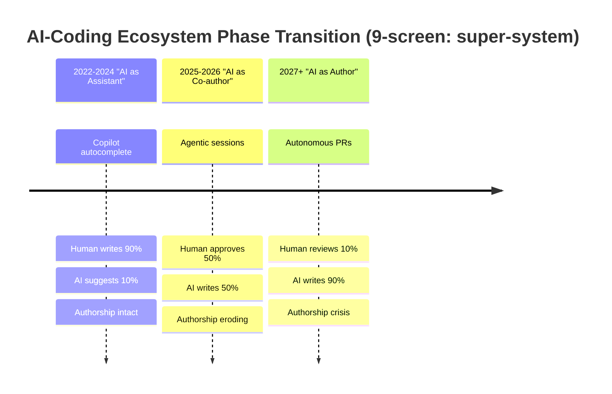
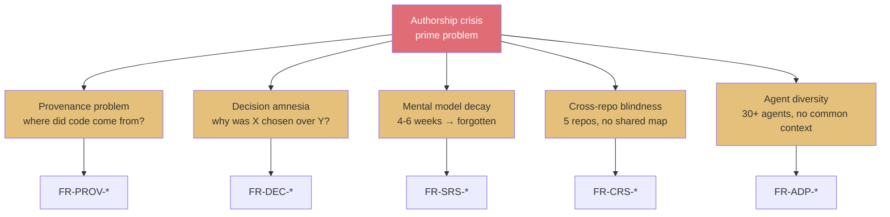
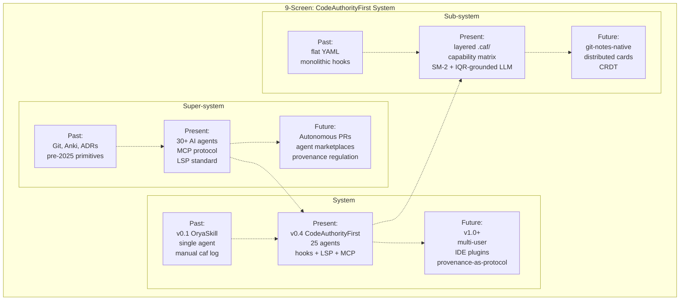
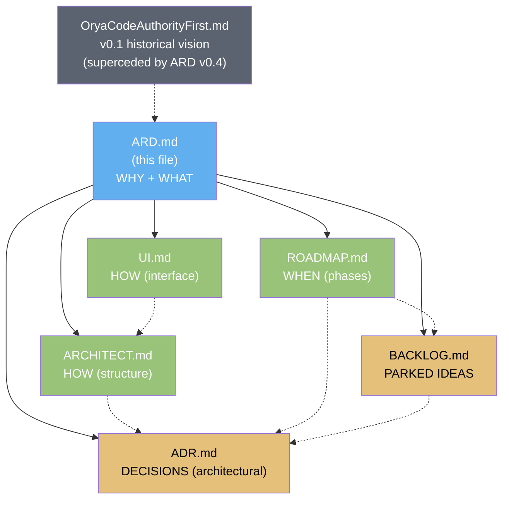

# CodeAuthorityFirst — ARD.md
# Architectural Requirements Document / Архитектурный документ требований

> **Версия / Version:** 0.4.0-triz2 (post-TRIZ-2 pass: ARD created de novo, fills the gap left by v0.3.1-triz which only had ADR; applies 80/20 to requirements themselves; applies TRIZ 40 principles + IQR + ARIZ-85B + 9-screen scheme to requirement conflicts)
> **Назначение / Purpose:** capture WHY this system exists, WHAT it must do, WHAT constraints bound it, and HOW we know it works. ARD sits above ARCHITECT (which captures HOW it is structured) and ROADMAP (which captures WHEN it ships). ADR captures individual architectural decisions; ARD captures the requirement space those decisions serve.
> **Принцип приоритизации / Prioritization principle:** 🔥 80/20 — every requirement carries an 80/20 verdict. Resources allocated proportionally. See [ADR-015](./ADR.md#adr-015-8020-prioritization-principle).
> **Язык / Language:** bilingual — Russian body, English summary per section
> **Аудитория / Audience:** architects proposing changes, maintainers auditing coverage, contributors proposing features, LLM agents traversing the codebase to understand intent
> **Связанные документы:** [ARCHITECT.md](./ARCHITECT.md) · [ROADMAP.md](./ROADMAP.md) · [BACKLOG.md](./BACKLOG.md) · [UI.md](./UI.md) · [ADR.md](./ADR.md) · [OryaCodeAuthorityFirst.md](./OryaCodeAuthorityFirst.md) (historical v0.1 vision)

---

## 0. 80/20 Verdict Table (Summary)

**EN summary.** Every functional and non-functional requirement in this document is tagged with an 80/20 verdict. The verdict determines how resources are allocated. This is the application of ADR-015 (80/20 prioritization) to requirements themselves — not just to features.

| Verdict | Meaning | Resource allocation | % of requirements |
|---------|---------|---------------------|-------------------|
| 🔥 **80/20** | High-leverage: 20% effort → 80% value. Core to product existence. | Disproportionate. Cannot be cut without breaking the product. | ~20% |
| ◐ **Supporting** | Required to make 🔥 work, but not itself the value driver. | Proportional. Cut only if 🔥 is preserved. | ~50% |
| ○ **Nice-to-have** | Quality-of-life; deferred to FUTURE unless cheap. | Minimal. Promote to ◐ only with pilot user + metric (ROADMAP §6.9). | ~30% |

**Allocation rule.** Of total engineering capacity: 60% to 🔥, 30% to ◐, 10% to ○. This is the operationalization of Pareto. When a sprint is over capacity, ○ items are cut first, then ◐ items that are not blockers for 🔥.

**TRIZ linkage.** Each verdict also encodes a TRIZ ideality judgement: 🔥 items increase ideality (value/cost ratio) the most. ○ items may even decrease ideality (more code, same value) and should be deferred unless they are cheap. See §6 TRIZ Analysis.

---

## 1. Vision

### 1.1 Problem statement

**EN summary.** When code in `Orya*`-style repositories is written by AI agents (opencode, Claude Code, Cursor, 25+ others), the human author loses their mental map of decisions and rejected alternatives. Git log records "what changed"; it does not record "what was considered and rejected", "which prompt produced this", or "why this approach over the obvious alternative". Without that map, safe evolution collapses: every change is taken in a vacuum, regressions accumulate, and architectural discussion degenerates to "ask the agent". CodeAuthorityFirst restores authorship by automatically capturing provenance, decision context, and applying spaced repetition to keep the mental map alive.

Когда код пишется AI-агентом, автор теряет ментальную карту принятых решений и отвергнутых альтернатив. Git log фиксирует «что изменилось», но не «что рассматривалось и было отвергнуто», «какой промпт породил это», «почему выбран этот подход, а не очевидная альтернатива». Без этой карты безопасная эволюция коллапсирует: каждое изменение принимается в вакууме, регрессии накапливаются, а архитектурная дискуссия вырождается в «спроси у агента».

`CodeAuthorityFirst` восстанавливает авторство, автоматически фиксируя provenance, контекст решений и применяя интервальное повторение для поддержания ментальной карты в активном состоянии. Это не инструмент для написания кода и не замена AI-агенту — это слой авторской памяти поверх существующего workflow.

### 1.2 Why now (TRIZ 9-screen: super-system trend)

**EN summary.** The super-system (AI-coding ecosystem) is in a phase transition: from "AI as assistant" (2022-2024, Copilot autocomplete) to "AI as author" (2025-2027, agentic sessions writing entire modules). Authorship-tools market is forming now; first-mover advantage is real but window closes within ~18 months. CodeAuthorityFirst enters the window when the pain is acute but no incumbent has crystallized the category.

Сверхсистема (AI-coding ecosystem) находится в фазовом переходе: от «AI как ассистент» (2022-2024, Copilot autocomplete) к «AI как автор» (2025-2027, агенные сессии, пишущие целые модули). Рынок инструментов авторства формируется сейчас; преимущество первого игрока реально, но окно закроется в течение ~18 месяцев.



**TRIZ Principle 25 (Self-service) applied.** The super-system trend is toward autonomous agents. CodeAuthorityFirst must not require human action to capture provenance — the system must capture itself. This drives the hooks-first architecture (ADR-003) and the universal pre-commit hook (🔥 80/20 feature #1).

### 1.3 Prime directive

> **Authorship-first.** Главная метрика — не покрытие кода тестами и не скорость разработки, а субъективная уверенность автора: «я могу объяснить этот код так, как будто написал его сам». Любая фича оценивается через этот критерий. (Source: OryaCodeAuthorityFirst.md §2)

This directive is invariant INV-ARD-004. Every requirement in this document is tested against it: does this requirement increase, preserve, or dilute authorship? Requirements that dilute authorship are rejected (see §8 Rejected Requirements).

---

## 2. Problem Decomposition

### 2.1 Five sub-problems (TRIZ 9-screen: system decomposition)



Each sub-problem decomposes to a cluster of functional requirements (FR-*). The decomposition is the foundation of §4.

### 2.2 Stakeholders

| Stakeholder | Interest | Power | Concern |
|-------------|----------|-------|---------|
| Solo developer using AI agents | Authorship preservation | High (decision-maker) | "Will this slow me down?" |
| Team lead of AI-assisted team | Onboarding new members | Medium | "Can a new hire understand AI-written code?" |
| OSS maintainer accepting AI PRs | Quality gate | Medium | "Did the contributor actually understand what they merged?" |
| Enterprise architect | Compliance, audit trail | High (blocker) | "Can we prove provenance for SOC2?" |
| AI agent (opencode, Claude Code, etc.) | Context injection | High (consumer) | "Give me context.md so I don't re-derive decisions" |
| MCP-aware client (Cursor, Cline) | Tool integration | Medium | "Expose caf.* tools over MCP" |
| LLM backend (z-ai-web-dev-sdk, Ollama) | Grounded narrative generation | Medium | "Don't hallucinate; ground in .caf/ facts" |

---

## 3. Success Criteria (OKR binding)

**EN summary.** Success criteria are the OKRs of the system. Each criterion maps to one or more functional requirements (§4) and is measured by a concrete metric (ROADMAP §5.3). Criteria are inherited from OryaCodeAuthorityFirst.md §12 and refined.

| ID | Criterion | Target | Phase | Owning FRs | Owning ADRs |
|----|-----------|--------|-------|------------|-------------|
| SC-1 | Authorship Confidence Score (ACS) | ≥3.5 sustained 4 weeks | BETA→PROD | FR-SRS-001..004 | ADR-002, ADR-006 |
| SC-2 | Decision Coverage | ≥90% non-trivial commits | ALPHA→PROD | FR-DEC-001..005 | ADR-003, ADR-004 |
| SC-3 | Mental Model Reach | ≥70% files covered | BETA | FR-SRS-005, FR-PROV-004 | ADR-002, ADR-013 |
| SC-4 | Recall Rate | ≥75% sustained 4 weeks | BETA→PROD | FR-SRS-003, FR-SRS-006 | ADR-002 |
| SC-5 | Agent Diversity (Shannon H) | ≥1.0 | PROD | FR-ADP-001..005 | ADR-009, ADR-012 |
| SC-6 | Adapter Coverage (native) | ≥70% of explicit adapters | PROD | FR-ADP-006 | ADR-012, ADR-013 |
| SC-7 | TUI first paint | <100ms | MVP | FR-UI-001 | ADR-014, INV-UI-001 |
| SC-8 | Hook fail-safe rate | 100% (never blocks session) | MVP | FR-REL-001 | ADR-003, INV-ARCH-004 |
| SC-9 | LLM hallucination rate in `caf.first_person_explain` | 0 on .caf/-grounded facts | PROD | FR-AI-001, FR-REL-002 | ADR-006, INV-ADR-006 |
| SC-10 | `.caf/` size per repo | <50 MB | MVP→PROD | FR-PERF-005 | ADR-001, INV-ADR-001 |

**OKR cascade.** Each success criterion cascades to a quarterly OKR. For example, SC-1 (ACS ≥3.5) becomes the Q1 objective "Authors report confident ownership of AI-generated code", with key results: (a) ACS ≥3.0 by end of BETA pilot week 4; (b) ACS ≥3.5 by PROD week 8; (c) ≥5 pilot users reporting ACS ≥3.5 for ≥4 consecutive weeks.

---

## 4. Functional Requirements

Functional requirements are grouped by the sub-problem they solve (§2.1). Each carries an 80/20 verdict (§0) and traces to success criteria (§3) and ADRs.

### 4.1 FR-PROV: Provenance (🔥 80/20 cluster)

**EN summary.** Provenance requirements capture "where did this code come from, in which AI session, from which prompt, producing which iterations". Provenance is the foundation layer — Decision Log and MMR cannot function without it.

| ID | Requirement | Verdict | Maps to | ADR | Phase |
|----|-------------|---------|---------|-----|-------|
| FR-PROV-001 | Every AI agent session gets a unique `session_id` and automatically logs to `.caf/sessions/<id>.yml` | 🔥 80/20 | SC-2 | ADR-001, ADR-003 | MVP |
| FR-PROV-002 | Session log contains: started_at, ended_at, agent, model, initial_prompt, iterations[], files_touched[], commit_sha, decisions_made[], voice_signature | 🔥 80/20 | SC-2 | ADR-001, ADR-005 | MVP |
| FR-PROV-003 | `caf who <file:line>` returns session, prompt, iteration for any line | 🔥 80/20 | SC-1 | ADR-003 | MVP |
| FR-PROV-004 | `caf when --pattern <regex> <path>` returns when a code pattern first appeared | ◐ Supporting | SC-3 | ADR-001 | ALPHA |
| FR-PROV-005 | `caf why <file>` links file to Decision Log entries | 🔥 80/20 | SC-1, SC-2 | ADR-003, ADR-004 | ALPHA |
| FR-PROV-006 | Sessions log is auto-pruned after 90 days unless referenced by a decision (keep provenance tight) | ○ Nice-to-have | SC-10 | ADR-001 | PROD |

**TRIZ Principle 5 (Combining) applied to FR-PROV-001/002.** Session_id combines git trailer (for cross-reference) + timestamp (for ordering) + random suffix (for uniqueness). One identifier serves three purposes — no separate "git trailer ID" vs "session ID" vs "log ID".

**TRIZ Principle 26 (Copying) applied to FR-PROV-003.** `caf who` mirrors `git blame` ergonomics (line-addressable, instant). Developers already know `git blame`; we copy the interaction pattern to eliminate learning cost. The copying is intentional — innovation here would slow adoption.

### 4.2 FR-DEC: Decision Log (🔥 80/20 cluster)

**EN summary.** Decision Log requirements capture "what was considered, what was chosen, what was rejected, what triggers reconsideration". The distinctive feature (vs. ADR) is that rejected alternatives are first-class — they are the long-term value.

| ID | Requirement | Verdict | Maps to | ADR | Phase |
|----|-------------|---------|---------|-----|-------|
| FR-DEC-001 | Every non-trivial edit (>50 LOC, excluding imports/formatting/tests — see ADR-004) requires a decision record or `CAF-Trivial: true` trailer | 🔥 80/20 | SC-2 | ADR-003, ADR-004 | ALPHA |
| FR-DEC-002 | Decision record contains: id, title, date, repo, session, files[], status, context, chosen, rejected_alternatives[], trade_offs, trigger_to_reconsider, @invariant tag | 🔥 80/20 | SC-2 | ADR-001, ADR-005 | ALPHA |
| FR-DEC-003 | `caf decisions new` provides TUI editor with autocomplete for files/tags/agent (90s → 25s fill time, 🔥 80/20) | 🔥 80/20 | SC-2 | ADR-014 | ALPHA |
| FR-DEC-004 | `caf decisions --gaps` surfaces non-trivial commits without a linked decision | 🔥 80/20 | SC-2 | ADR-003 | ALPHA |
| FR-DEC-005 | `caf decisions --search <query>` performs full-text search across all decision records, including rejected alternatives | ◐ Supporting | SC-2 | ADR-005 | ALPHA |
| FR-DEC-006 | Decisions are never deleted; supersession is the only path (`Status: superseded by ADR-NNN`) | ◐ Supporting | SC-2 | ADR (template §0) | MVP |
| FR-DEC-007 | Each decision carries `@invariant` tag for properties that must hold across future commits | ◐ Supporting | SC-2, SC-8 | ADR (template §0), ADR-029 (proposed) | PROD |

**TRIZ Principle 10 (Preliminary action) applied to FR-DEC-001.** Pre-commit hook prepares the decision record BEFORE the commit lands. This is preliminary action: the friction happens before the irreversible action (commit), not after. The 30-second interruption is the price of long-term memory.

**TRIZ Principle 11 (Beforehand cushioning) applied to FR-DEC-002.** The `trigger_to_reconsider` field is a beforehand cushion: it pre-records the conditions under which the decision should be revisited. When the trigger fires (e.g., `.caf/` exceeds 50 MB), the system knows to revisit ADR-001 — no human needs to remember.

### 4.3 FR-SRS: Mental Model Reconstructor (🔥 80/20 cluster)

**EN summary.** MMR requirements capture "spaced repetition of code knowledge". Without SRS, the mental map decays in 4-6 weeks (cognitive science). SM-2 algorithm (Anki-compatible, since 1987) provides the schedule.

| ID | Requirement | Verdict | Maps to | ADR | Phase |
|----|-------------|---------|---------|-----|-------|
| FR-SRS-001 | Three card types: `why` (fact recall), `what_if_remove` (abstract reasoning), `where_handled` (trace through code) | 🔥 80/20 | SC-1, SC-3 | ADR-002 | BETA |
| FR-SRS-002 | SM-2 algorithm: ease_factor ∈ [1.3, 3.0], interval = max(1d, prior × ease × grade_modifier) | 🔥 80/20 | SC-1, SC-4 | ADR-002, INV-ARCH-006 | BETA |
| FR-SRS-003 | `caf review` runs daily SRS session, ~10 min, 10-15 cards due | 🔥 80/20 | SC-1, SC-4 | ADR-014 | BETA |
| FR-SRS-004 | Cards auto-generated from decisions (Type 1) and dependency graph (Types 2, 3) | 🔥 80/20 | SC-3 | ADR-002, ADR-011 | BETA |
| FR-SRS-005 | `caf review --blindspots` surfaces files with no SRS card coverage | ◐ Supporting | SC-3 | ADR-002 | BETA |
| FR-SRS-006 | `caf review --hard` shows only cards with low ease (memory struggling) | ○ Nice-to-have | SC-4 | ADR-002 | BETA |
| FR-SRS-007 | Per-card-type ease baseline: Type 2 (what_if_remove) starts 2.0 (harder), Type 1 starts 2.5 (standard) — adaptive difficulty (BACKLOG D-007) | ○ Nice-to-have | SC-4 | ADR-002 (proposed supersession) | FUTURE |

**TRIZ Principle 35 (Parameter change) applied to FR-SRS-002.** SM-2's ease_factor is the parameter that changes state — it adapts to the user's actual recall performance. This is the system "learning" the user without ML. The adaptation is mechanical (rule-based), transparent, and debuggable — qualities lost in ML-based schedulers like FSRS.

**TRIZ Principle 2 (Taking out) applied to FR-SRS-001.** We "take out" the answer from the card — the user produces the answer internally before revealing. This is the active recall principle: passive reading does not consolidate memory; active production does. The card design forces production.

### 4.4 FR-CRS: Cross-repo Sync (◐ Supporting cluster)

**EN summary.** Cross-repo requirements capture "when one repo's interface changes, which decisions in dependent repos become stale?". Five `Orya*` repos (or any polyrepo setup) share a mental graph via `manifest.yml`.

| ID | Requirement | Verdict | Maps to | ADR | Phase |
|----|-------------|---------|---------|-----|-------|
| FR-CRS-001 | Each repo has `.caf/manifest.yml` declaring depends_on[] and exposes[] | ◐ Supporting | SC-3 | ADR-001 | PROD |
| FR-CRS-002 | `caf sync` detects locally-cloned repos via `~/.caf/repos.yml` registry | ◐ Supporting | SC-3 | ADR-001 | PROD |
| FR-CRS-003 | When interface in repo A changes, repo B (depending on A) gets a "review-because-interface-changed" card | 🔥 80/20 | SC-3 | ADR-001, ADR-011 | PROD |
| FR-CRS-004 | Manifest cache TTL = 1 hour in `~/.caf/manifest-cache/` | ◐ Supporting | SC-3 | (config schema) | PROD |
| FR-CRS-005 | Private repos supported via git credential helper | ◐ Supporting | SC-3 | ADR-022 (future) | PROD |

### 4.5 FR-ADP: Adapter Pattern (🔥 80/20 cluster)

**EN summary.** Adapter requirements capture "25+ AI agents need integration; universal fallback covers 100%". The capability matrix makes each adapter's limitations explicit.

| ID | Requirement | Verdict | Maps to | ADR | Phase |
|----|-------------|---------|---------|-----|-------|
| FR-ADP-001 | Each agent implements `Adapter` interface: ID, Capabilities, Install, Uninstall, Detect (5 methods) | 🔥 80/20 | SC-5, SC-6 | ADR-009, INV-ARCH-002 | MVP |
| FR-ADP-002 | Capability matrix is a first-class artifact: 3 canonical events × {native, wrapper, watcher, universal} per adapter | 🔥 80/20 | SC-6 | ADR-009 | MVP |
| FR-ADP-003 | Universal pre-commit hook fires for all 25+ agents (🔥 80/20 feature #1) | 🔥 80/20 | SC-2, SC-6 | ADR-003, ADR-010 | MVP |
| FR-ADP-004 | Universal LSP fallback (Tier 4) covers any LSP-supporting language with zero config | 🔥 80/20 | SC-6 | ADR-013, INV-ARCH-003 | MVP |
| FR-ADP-005 | `caf init --auto-detect` finds installed agents in <5s and recommends with marker | 🔥 80/20 | SC-5 | ADR-012 | MVP |
| FR-ADP-006 | 25 explicit adapters ship across 4 tiers (5+8+12) + 1 universal = 28 total coverage | ◐ Supporting | SC-6 | ADR-012 | MVP→PROD |
| FR-ADP-007 | Adapter contract tests: 25 × 3 events = 78 cases in CI | ◐ Supporting | SC-6 | ADR-009 | MVP→PROD |

**TRIZ Principle 1 (Segmentation) applied to FR-ADP-001.** Adapter is segmented into 5 methods — each can be tested independently, each can be implemented independently. Adding a new agent = adding one file under `internal/adapters/<agent>/`. Segmentation enables parallel development and parallel testing.

**TRIZ Principle 13 (The other way round) applied to FR-ADP-003.** Instead of "agent tells caf about commits", we invert: "git tells caf about commits via pre-commit hook". The universal hook is agent-agnostic — git is the common denominator. This is why one hook covers 25+ agents: we don't ask agents anything.

### 4.6 FR-UI: User Interface (🔥 80/20 cluster)

**EN summary.** UI requirements capture "TUI-first, sub-100ms response, keyboard-only operation possible". Three UI-velocity patterns (Critical CSS, Islands, Skeleton/SWR) are native to the TUI stack.

| ID | Requirement | Verdict | Maps to | ADR | Phase |
|----|-------------|---------|---------|-----|-------|
| FR-UI-001 | TUI first paint <100ms on pilot repos | 🔥 80/20 | SC-7 | ADR-014, INV-UI-001 | MVP |
| FR-UI-002 | Frame render <16ms (60fps) for scroll/redraw | ◐ Supporting | SC-7 | ADR-014, INV-UI-002 | MVP |
| FR-UI-003 | Keystroke response <50ms for simple actions | ◐ Supporting | SC-7 | ADR-014, INV-UI-003 | MVP |
| FR-UI-004 | Every async data load returns Skeleton{} immediately, then DataLoadedMsg swaps (SWR pattern) | 🔥 80/20 | SC-7 | INV-UI-004 | MVP |
| FR-UI-005 | Screens mount lazily on first navigation (Islands/partial hydration analogue) | ◐ Supporting | SC-7 | INV-UI-005 | MVP |
| FR-UI-006 | Lipgloss pre-computes style strings at startup (Critical CSS analogue) | ◐ Supporting | SC-7 | INV-UI-006 | MVP |
| FR-UI-007 | Universal keyboard map: `?` help, `q`/`Ctrl+C` quit, `Esc` back, `j`/`k` vim-style, `Enter` activate | ◐ Supporting | SC-7 | ADR-014 | MVP |
| FR-UI-008 | 11 TUI screens: onboarding, dashboard, review, decisions list/detail/editor, heatmap, adapters, file tour, reports, settings | ◐ Supporting | SC-7 | ADR-014 | MVP→PROD |
| FR-UI-009 | Color-blind friendly: pair color with text/symbol, never color-only | ◐ Supporting | SC-7 | (accessibility) | BETA |
| FR-UI-010 | Responsive layout: ≥140 cols full grid, 100-139 2-col, 60-99 single stacked, <60 compact | ◐ Supporting | SC-7 | ADR-014 | MVP |

### 4.7 FR-AI: LLM Features (◐ Supporting cluster, PROD phase)

**EN summary.** LLM requirements capture "first-person narrative generation, grounded in `.caf/` facts, no hallucination". The killer feature is `caf.first_person_explain` MCP tool.

| ID | Requirement | Verdict | Maps to | ADR | Phase |
|----|-------------|---------|---------|-----|-------|
| FR-AI-001 | `caf.first_person_explain` MCP tool returns LLM-generated first-person narrative grounded in `.caf/` facts | 🔥 80/20 | SC-9 | ADR-006, INV-ADR-006 | PROD |
| FR-AI-002 | LLM only paraphrases `.caf/`-grounded facts; never invents; if facts missing, returns "no provenance for this file" | 🔥 80/20 | SC-9 | ADR-006, INV-ADR-006 | PROD |
| FR-AI-003 | LLM backend configurable: `z-ai-web-dev-sdk` (default), local Ollama, custom endpoint | ◐ Supporting | SC-9 | ADR-017 (future) | PROD |
| FR-AI-004 | `caf decisions new --ai-prefill` drafts decision fields from diff; user edits; opt-in | ◐ Supporting | SC-2 | ADR-017 (future) | PROD |
| FR-AI-005 | Graceful degradation: if LLM unavailable, template-based fallback narrative (no LLM, just string formatting) | ◐ Supporting | SC-9 | ADR-006, BACKLOG J-007 | PROD |
| FR-AI-006 | On-premise LLM deployment for enterprise (no diff leaves the network) | ○ Nice-to-have | SC-9 | ADR-017 (future), BACKLOG F-004 | PROD |

### 4.8 FR-SEC: Security (NEW in v0.4-triz2, ◐ Supporting cluster)

**EN summary.** Security requirements were implicit in v0.3.1-triz; v0.4-triz2 makes them explicit. Threat model: malicious `.caf/` content from cloned repos, supply-chain attacks via adapters, LLM data exfiltration.

| ID | Requirement | Verdict | Maps to | ADR | Phase |
|----|-------------|---------|---------|-----|-------|
| FR-SEC-001 | `.caf/` content from untrusted repos is parsed in sandboxed YAML parser (no `os.Execute`, no file writes outside `.caf/`) | ◐ Supporting | SC-8 | ADR-005, ADR-022 (future) | ALPHA |
| FR-SEC-002 | Adapters are signed (GPG/cosign); `caf adapters install` verifies signature before install | ◐ Supporting | SC-8 | ADR-028 (future), ADR-022 (future) | PROD |
| FR-SEC-003 | LLM calls never include full file contents; only diff summaries + decision records (privacy) | 🔥 80/20 | SC-9 | ADR-006, ADR-017 (future) | PROD |
| FR-SEC-004 | `caf config set llm.backend local-ollama` enables fully offline mode (no data leaves machine) | ◐ Supporting | SC-9 | ADR-017 (future), BACKLOG F-004 | PROD |
| FR-SEC-005 | Audit log: `.caf/audit.log` append-only with hash chain (Merkle-style); `caf audit --since 7d` | ○ Nice-to-have | SC-8 | BACKLOG F-002 | FUTURE |
| FR-SEC-006 | No telemetry by default; opt-in via `caf config set telemetry.enabled true`; no content sent | ◐ Supporting | SC-8 | BACKLOG J-004, ADR-019 (future) | PROD |

**TRIZ Principle 22 (Blessing in disguise) applied to FR-SEC-003.** The privacy constraint (don't send full files to LLM) is also a quality constraint: LLM hallucinates less when given less context. The constraint that "protects" also "improves". This is a TRIZ blessing — the disadvantage (limited context) becomes an advantage (less hallucination).

### 4.9 FR-OBS: Observability (NEW in v0.4-triz2, ◐ Supporting cluster)

**EN summary.** Observability requirements capture "how do we know the system is healthy in production?". OpenTelemetry integration; metrics export to Prometheus/Grafana.

| ID | Requirement | Verdict | Maps to | ADR | Phase |
|----|-------------|---------|---------|-----|-------|
| FR-OBS-001 | Every `caf` command emits OpenTelemetry span (command name, duration, exit code) | ◐ Supporting | SC-8 | (new ADR needed) | PROD |
| FR-OBS-002 | `.caf/metrics.jsonl` rolling log of all success metrics (ACS, coverage, recall) — daily snapshot | ◐ Supporting | SC-1..6 | ADR-015 | PROD |
| FR-OBS-003 | `caf metrics --export prometheus` exposes HTTP endpoint `/metrics` for Prometheus scrape | ◐ Supporting | SC-8 | BACKLOG I-005 | PROD |
| FR-OBS-004 | `caf doctor` runs health checks: `.caf/` integrity, adapter health, LSP availability, hook installation | 🔥 80/20 | SC-8 | BACKLOG J-001 | ALPHA |
| FR-OBS-005 | Grafana dashboard template shipped in `docs/grafana/caf-dashboard.json` | ○ Nice-to-have | SC-8 | BACKLOG I-005 | FUTURE |

### 4.10 FR-PERF: Performance (◐ Supporting cluster)

**EN summary.** Performance requirements are inherited from UI.md §0.3 (universal performance budget) and made explicit at the requirements layer.

| ID | Requirement | Verdict | Maps to | ADR | Phase |
|----|-------------|---------|---------|-----|-------|
| FR-PERF-001 | `caf dashboard` first paint <100ms on repo with 1000 sessions | 🔥 80/20 | SC-7 | ADR-014, INV-UI-001 | MVP |
| FR-PERF-002 | `caf review` card render <50ms (no LLM) | ◐ Supporting | SC-7 | INV-UI-002 | BETA |
| FR-PERF-003 | `caf heatmap` render <200ms on 247-file repo; <500ms incremental recompute | ◐ Supporting | SC-7 | INV-UI-007 | BETA |
| FR-PERF-004 | `caf sync` on 10k-file repo <1s (incremental, not full parse) | ◐ Supporting | SC-3 | BACKLOG A-003 | PROD |
| FR-PERF-005 | `.caf/` size per repo <50 MB (mitigations: lazy loading, streaming parser, git-lfs for archives) | ◐ Supporting | SC-10 | ADR-001, INV-ADR-001 | MVP→PROD |
| FR-PERF-006 | LLM-dependent operations <3s (with skeleton + spinner, never blocking UI) | ◐ Supporting | SC-7 | INV-UI-004 | PROD |

### 4.11 FR-REL: Reliability (🔥 80/20 cluster)

**EN summary.** Reliability requirements capture "the system must never block the user's work". Fail-safe is the prime reliability directive.

| ID | Requirement | Verdict | Maps to | ADR | Phase |
|----|-------------|---------|---------|-----|-------|
| FR-REL-001 | Hook execution is fail-safe: `caf` binary missing → warn-and-continue, never block session/commit | 🔥 80/20 | SC-8 | ADR-003, INV-ARCH-004 | MVP |
| FR-REL-002 | `caf.first_person_explain` degrades gracefully: LLM down → template-based fallback (INV-ADR-006 preserved) | 🔥 80/20 | SC-9 | ADR-006, BACKLOG J-007 | PROD |
| FR-REL-003 | `caf doctor` detects and self-heals `.caf/` after git rebase/reset (rebuilds index from YAML source of truth) | 🔥 80/20 | SC-8 | BACKLOG J-001 | ALPHA |
| FR-REL-004 | `caf review` crash mid-session loses no progress (atomic writes, incremental save after each card) | ◐ Supporting | SC-8 | BACKLOG J-002 | MVP |
| FR-REL-005 | Adapter failure in one adapter does not block other adapters (error isolation) | ◐ Supporting | SC-8 | ADR-009 | MVP |
| FR-REL-006 | `caf backup` creates tarball to S3 or local; `caf restore` reverses | ○ Nice-to-have | SC-8 | BACKLOG J-006 | FUTURE |

---

## 5. Non-Functional Requirements

NFRs are constraints on HOW the system achieves FRs. Each NFR has a measurable target and traces to one or more FRs.

### 5.1 NFR-PERF: Performance envelope

| ID | Constraint | Target | Owning FRs |
|----|-----------|--------|------------|
| NFR-PERF-01 | Latency P95 for any CLI command | <500ms (no LLM) / <3s (LLM) | FR-UI-001..003, FR-AI-001 |
| NFR-PERF-02 | Throughput: `caf sync` on monorepo (100 services) | <30s (with caching) | FR-CRS-002, FR-PERF-004 |
| NFR-PERF-03 | Memory footprint: `caf dashboard` resident | <50 MB | FR-UI-001, FR-PERF-001 |
| NFR-PERF-04 | `.caf/` storage budget per repo | <50 MB | FR-PERF-005 |
| NFR-PERF-05 | Cold start: `caf init` to first useful output | <30s (auto-detect + install) | FR-ADP-005 |

### 5.2 NFR-REL: Reliability envelope

| ID | Constraint | Target | Owning FRs |
|----|-----------|--------|------------|
| NFR-REL-01 | Hook fail-safe rate | 100% (never blocks session/commit) | FR-REL-001 |
| NFR-REL-02 | Data loss tolerance | 0 cards lost on crash (atomic writes) | FR-REL-004 |
| NFR-REL-03 | LLM hallucination rate on `.caf/`-grounded facts | 0 (no fabricated decisions) | FR-AI-002, SC-9 |
| NFR-REL-04 | Adapter isolation: one adapter failure blocks | 0 other adapters | FR-REL-005 |

### 5.3 NFR-SEC: Security envelope

| ID | Constraint | Target | Owning FRs |
|----|-----------|--------|------------|
| NFR-SEC-01 | `.caf/` parser sandbox | No `os.Execute`, no file writes outside `.caf/` | FR-SEC-001 |
| NFR-SEC-02 | Adapter signature verification | 100% of community adapters signed | FR-SEC-002 |
| NFR-SEC-03 | LLM data minimization | Only diff summaries + decision records sent; never full files | FR-SEC-003 |
| NFR-SEC-04 | Telemetry opt-in | 0 bytes sent without explicit opt-in | FR-SEC-006 |

### 5.4 NFR-USE: Usability envelope

| ID | Constraint | Target | Owning FRs |
|----|-----------|--------|------------|
| NFR-USE-01 | Onboarding time (fresh repo to first `caf dashboard`) | <30s | FR-ADP-005, FR-UI-001 |
| NFR-USE-02 | Decision editor fill time | <30s (with autocomplete) | FR-DEC-003 |
| NFR-USE-03 | Daily SRS review time | ~10 min (10-15 cards) | FR-SRS-003 |
| NFR-USE-04 | Keyboard-only operation completeness | 100% (no mouse required) | FR-UI-007 |

### 5.5 NFR-MAINT: Maintainability envelope

| ID | Constraint | Target | Owning FRs |
|----|-----------|--------|------------|
| NFR-MAINT-01 | Test coverage (unit) | ≥80% | (cross-cutting) |
| NFR-MAINT-02 | Adapter contract tests | 25×3=78 cases in CI | FR-ADP-007 |
| NFR-MAINT-03 | Property-based tests for SM-2 | 1000 random card generations, ease ∈ [1.3, 3.0] | FR-SRS-002 |
| NFR-MAINT-04 | Documentation drift | 0 (caf doc-check verifies cross-refs) | ADR-029 (proposed) |
| NFR-MAINT-05 | Backwards compatibility | `.caf/` schema additive across major versions | ADR-001, INV-ADR-001 |

---

## 6. TRIZ Analysis

### 6.1 Application of 40 inventive principles (selected, high-impact)

**EN summary.** Of the 40 TRIZ inventive principles, the following have direct application to CodeAuthorityFirst. Each principle is mapped to a requirement or ADR it shaped. Principles not listed had no high-impact application in this domain.

| Principle | Application | Owning ADR/FR | Outcome |
|-----------|-----------|---------------|---------|
| 1. Segmentation | Adapter interface split into 5 independent methods | ADR-009, FR-ADP-001 | New adapter = 1 file; parallel test/dev |
| 2. Taking out | SRS card "takes out" the answer — user produces internally | ADR-002, FR-SRS-001 | Active recall replaces passive reading |
| 5. Combining | `session_id` combines git trailer + timestamp + randomness | ADR-001, FR-PROV-001 | One ID serves 3 purposes |
| 10. Preliminary action | Pre-commit hook prepares decision BEFORE commit lands | ADR-003, FR-DEC-001 | Friction before irreversible action |
| 11. Beforehand cushioning | `trigger_to_reconsider` field pre-records revisit conditions | ADR template, FR-DEC-007 | System self-triggers re-evaluation |
| 13. The other way round | Git tells caf about commits (not agent tells caf) | ADR-003, FR-ADP-003 | Universal coverage via git, not 25 agent APIs |
| 15. Dynamicity | Capability matrix is data-driven, not hardcoded | ADR-009, FR-ADP-002 | New tier = data change, not code change |
| 22. Blessing in disguise | LLM data minimization also reduces hallucination | FR-SEC-003, FR-AI-002 | Privacy constraint improves quality |
| 25. Self-service | Hooks capture provenance automatically, no manual `caf log` | ADR-003, FR-PROV-001 | Capture rate ~100% vs <30% manual |
| 26. Copying | `caf who` mirrors `git blame` ergonomics | FR-PROV-003 | Zero learning curve |
| 28. Mechanics substitution | LLM paraphrases; rules ground; humans approve | ADR-006, FR-AI-002 | LLM amplifies, doesn't replace |
| 35. Parameter change | SM-2 ease_factor adapts to user recall | ADR-002, FR-SRS-002 | Mechanical adaptation, no ML needed |
| 36. Phase transition | CLI → MCP shifts integration cost to consumers | FR-AI-001, FR-ADP-002 | One MCP server serves all MCP clients |

### 6.2 IQR (Ideal Final Result)

**IQR-1 (system level).** The ideal CodeAuthorityFirst occupies zero author attention at steady state. The author writes code with AI agents, commits, and periodically reviews. `.caf/` populates itself via hooks; decisions are prompted only at the friction point (pre-commit); SRS cards surface in the daily review. The author never explicitly invokes `caf log` or `caf decisions new` (except via the pre-commit prompt). 

**IQR-2 (component level).** The ideal `.caf/` storage does not exist as a separate artifact — it IS the git history, augmented. Future state: `.caf/` shrinks to near-zero by inlining provenance trailers into git commit messages and storing decision records as git notes. The `.caf/` folder becomes a cache, not a source of truth; git itself is the source of truth. This is the long-term direction (FUTURE).

**IQR-3 (process level).** The ideal SRS review session takes zero time — the author answers cards as part of the natural workflow (e.g., when opening a file in the editor, the relevant "why" card surfaces as a hover tooltip). The 10-minute daily review session is a transitional compromise until IDE plugins (BACKLOG B-001..B-003) make SRS ambient.

### 6.3 ARIZ-85B: LLM hallucination contradiction

**EN summary.** The hardest technical contradiction in the system: `caf.first_person_explain` needs an LLM to produce fluent first-person narrative, but LLMs hallucinate, and hallucinated decisions are worse than no narrative at all (they fabricate authorship). ARIZ-85B resolves this by separating the function (paraphrase) from the constraint (no invention).

**Step 1: Problem formulation.**
- Technical contradiction 1: LLM produces fluent narrative (improves) but introduces hallucination risk (worsens).
- Technical contradiction 2: Restricting LLM to template-based output eliminates hallucination (improves) but loses fluency and personalization (worsens).

**Step 2: Resource analysis.**
- Available resources: `.caf/` facts (decisions, sessions, provenance), LLM capability (paraphrase), template structure, git history.
- Harmful resources: LLM training data biases, model tendency to "fill in" missing context.

**Step 3: Ideal final result.**
The LLM produces a fluent first-person narrative using ONLY facts present in `.caf/`. If facts are missing, the LLM explicitly says "no provenance for this file" rather than inventing. The narrative reads naturally but every sentence is traceable to a `.caf/` source.

**Step 4: Resolution.**
Apply Principle 28 (Mechanics substitution): substitute the LLM's "generation" function with "paraphrase" function. The LLM does not generate content; it paraphrases existing content. This is enforced by:
1. **Prompt engineering**: system prompt says "You are paraphrasing `.caf/` facts. Do not add information. If a fact is missing, say 'no provenance'."
2. **Grounding check**: post-generation, the narrative is parsed and each claim is matched against `.caf/` source. Unmatched claims trigger fallback to template.
3. **Test suite**: a corpus of `.caf/` fixtures with known facts; LLM output is verified against the corpus. Any unmatched claim fails the test (NFR-REL-03: 0 hallucination).

This is codified in ADR-006, INV-ADR-006: "LLM only paraphrases `.caf/`-grounded facts, never invents."

**Step 5: Verification.**
- SC-9 (LLM hallucination rate = 0 on `.caf/`-grounded facts) is the measurable target.
- Test suite (BACKLOG J-005, fuzzing for `.caf/` parser) extended to include LLM hallucination tests.

### 6.4 9-Screen Scheme (Multi-screen thinking)



**Insight from 9-screen analysis.** The super-system future (autonomous PRs, provenance regulation) suggests that provenance capture must become a protocol, not a tool. The sub-system future (git-notes-native, CRDT) suggests the storage layer will dissolve into git itself. The system-level present (CodeAuthorityFirst v0.4) is the transitional form — explicit `.caf/` folder, explicit hooks. The trajectory is toward dissolution.

**Strategic implication.** CodeAuthorityFirst should not over-invest in `.caf/`-as-storage; it should invest in `.caf/`-as-cache that can be regenerated from git + git-notes. This preserves the option to dissolve `.caf/` in v2.0 without losing data. (Captured as a constraint in §7.)

---

## 7. Constraints

**EN summary.** Constraints are non-negotiable boundaries within which the system must operate. They are inherited from ADRs and from external context (technology choices, ecosystem constraints).

| ID | Constraint | Source | Implication |
|----|-----------|--------|-------------|
| C-01 | Single Go binary distribution; no runtime dependencies | ADR-008, ADR-014 | No Node.js, no Python, no Electron; all CGO optional |
| C-02 | `.caf/` committed in-repo; YAML 1.2 + Markdown only | ADR-001, ADR-005 | No SQLite, no binary formats; checkout-time-travel preserved |
| C-03 | TUI-first; web UI deferred to FUTURE | ADR-014 | Sub-100ms first paint; SSH/Docker/CI coverage |
| C-04 | Hooks fail-safe; never block session/commit | ADR-003, INV-ARCH-004 | `.caf/` corruption → warn, not block |
| C-05 | Adapter interface stable within major version; 5 methods | ADR-009, INV-ARCH-002 | New methods = default-implemented; signatures never change |
| C-06 | `.caf/` schema additive across major versions | ADR-001, INV-ADR-001 | Old fields never removed; `caf migrate` for breaking changes |
| C-07 | No external infrastructure required for MVP/ALPHA/BETA | (new in v0.4) | No database, no server, no LLM in MVP/ALPHA/BETA |
| C-08 | LLM is opt-in; default works without LLM | ADR-017 (future), FR-AI-003 | Privacy by default; LLM only in PROD with explicit config |
| C-09 | `.caf/` is cache-friendly; can be regenerated from git + decisions | (new in v0.4, from 9-screen) | Storage layer must remain regenerable; dissolution option preserved |
| C-10 | Authorship-first is prime; no requirement may dilute it | INV-ARD-004 | Conflicts resolved in favor of authorship |

---

## 8. Assumptions

| ID | Assumption | Risk if wrong | Mitigation |
|----|-----------|---------------|-----------|
| A-01 | AI agents will continue to support git hooks (or wrappers can simulate them) | HIGH — if agents move to MCP-only, hook coverage drops | ADR-013 universal LSP + ADR-010 wrapper/watcher fallback chain |
| A-02 | Users want first-person narrative (not third-person or passive) | MEDIUM — cultural variation | ADR-006 with `trigger_to_reconsider` for multi-user mode (FUTURE) |
| A-03 | SM-2 is sufficient; FSRS not needed | LOW — well-tested algorithm | ADR-002 trigger: if recall <60% fleet-wide after 90 days |
| A-04 | 50 LOC triviality threshold is correct for typical repos | MEDIUM — too aggressive or too permissive | ADR-004 configurable per-repo via `.caf/config.yml` |
| A-05 | LSP is available for target languages (Go, Python, TS, Rust, Java, C#) | LOW — LSP is standard | ADR-013 falls back to filesystem-only for non-LSP languages |
| A-06 | `.caf/` will stay under 50 MB per repo for textual data | LOW — text is small | ADR-001 trigger: if exceeded, hybrid YAML + git-lfs |
| A-07 | Users will tolerate 30-second decision-prompt friction at pre-commit | MEDIUM — adoption risk | Mitigation: autocomplete (FR-DEC-003); `CAF-Trivial: true` bypass |
| A-08 | MCP protocol will remain stable (Anthropic not breaking it) | MEDIUM — external dependency | Pin MCP spec version; contract tests against pinned version |
| A-09 | The 80/20 verdict assignments in §4 are correct | MEDIUM — misallocation of resources | Quarterly re-evaluation (ADR-015 step 5) |

---

## 9. Trace Matrix

**EN summary.** Every requirement traces to (a) a success criterion, (b) an ADR, and (c) a phase. This matrix is the bidirectional traceability that lets an agent or auditor verify coverage in both directions.

| FR/NFR | Success Criterion | ADR | Phase | BACKLOG items affected |
|--------|-------------------|-----|-------|------------------------|
| FR-PROV-001..006 | SC-2, SC-3 | ADR-001, ADR-003, ADR-005 | MVP→ALPHA | A-002, A-003, A-005, J-001, J-008 |
| FR-DEC-001..007 | SC-2 | ADR-003, ADR-004, ADR-005, ADR-014 | ALPHA | H-006, D-001, J-008 |
| FR-SRS-001..007 | SC-1, SC-3, SC-4 | ADR-002, ADR-011, ADR-014 | BETA | D-002, D-004, D-007, H-001 |
| FR-CRS-001..005 | SC-3 | ADR-001, ADR-011, ADR-022 (future) | PROD | A-003, A-006, C-006 |
| FR-ADP-001..007 | SC-5, SC-6 | ADR-009, ADR-010, ADR-012, ADR-013 | MVP→PROD | E-001..E-008, H-002, H-005 |
| FR-UI-001..010 | SC-7 | ADR-014 | MVP→PROD | K-001..K-012 |
| FR-AI-001..006 | SC-9 | ADR-006, ADR-017 (future) | PROD | D-001, D-002, D-003, D-008, J-007 |
| FR-SEC-001..006 | SC-8, SC-9 | ADR-005, ADR-022 (future), ADR-028 (future) | ALPHA→PROD | F-001..F-007 (new gaps) |
| FR-OBS-001..005 | SC-8 | (new ADR needed), ADR-015 | PROD | I-001, I-005, J-001, J-004 |
| FR-PERF-001..006 | SC-7, SC-10 | ADR-001, ADR-014 | MVP→PROD | A-001, A-002, A-003, A-005 |
| FR-REL-001..006 | SC-8, SC-9 | ADR-003, ADR-006, ADR-009 | MVP→PROD | J-001, J-002, J-006, J-007 |

---

## 10. Rejected Requirements (TRIZ-informed rejections)

**EN summary.** Some requirements were considered and rejected. Documenting rejections preserves the reasoning — future contributors who re-propose these ideas can be pointed here.

| ID | Rejected requirement | Rejection reason | TRIZ principle invoked |
|----|---------------------|------------------|------------------------|
| RR-01 | Real-time collaborative editing of `.caf/` files | Decisions are mostly write-once; real-time adds CRDT complexity for marginal value | Principle 3 (Local quality): decisions don't need real-time; they need durability |
| RR-02 | AI agent that automatically fills decisions without human approval | LLM hallucination risk without grounding; violates authorship-first (INV-ARD-004) | Principle 28 (Mechanics substitution): LLM amplifies human, doesn't replace |
| RR-03 | Mobile app for `caf review` | Voice-first review (BACKLOG D-006) covers use case without platform-specific dev | Principle 4 (Asymmetry): voice works on mobile without an app |
| RR-04 | Gamification (badges, streaks) | Contradicts first-person voice (ADR-006); creates gaming incentives | Principle 22 (Blessing in disguise): seriousness is a feature, not a bug |
| RR-05 | Public leaderboard of ACS scores | ACS is subjective; public comparison creates gaming risk | Principle 22 (Blessing in disguise): private progress is honest progress |
| RR-06 | Automatic decision generation from git log | Git log lacks alternatives/trade-offs; LLM would invent reasons (NFR-REL-03 violation) | Principle 28 (Mechanics substitution): human generates, not LLM |
| RR-07 | Blockchain-based provenance | Git history already tamper-evident; blockchain adds complexity, no value | Principle 1 (Segmentation): don't add layers when one suffices |

---

## 11. Open Architectural Questions

These questions require future ADRs to resolve. They are listed here so contributors know what is undecided.

| # | Question | Phase needed | Owning ADR (future) | Trace |
|---|----------|--------------|---------------------|-------|
| 1 | `caf init --auto-detect` — offer all detected adapters, or auto-install recommended only? | MVP | (TBD) | FR-ADP-005 |
| 2 | Default LSP server for Go: bundle `gopls` in `caf` binary, or require install? | MVP | ADR-026 | FR-ADP-004, FR-REL-001 |
| 3 | LLM backend default: `z-ai-web-dev-sdk` vs local Ollama vs configurable? | PROD | ADR-017 | FR-AI-003 |
| 4 | Multi-user conflict resolution for `ease_factor`: minimum wins or latest wins? | FUTURE | ADR-016 | FR-SRS-002, BACKLOG G-001 |
| 5 | Adapter contribution governance: marketplace vs GitHub-only? | FUTURE | ADR-018, ADR-028 | FR-ADP-001, FR-SEC-002 |
| 6 | Telemetry data ownership: anonymous-only vs attributed? | PROD | ADR-019, ADR-027 | FR-SEC-006 |
| 7 | Schema migration strategy for breaking changes (when v2.0 happens)? | ALPHA | ADR-020 | FR-PERF-005, C-06 |
| 8 | Card type extension: built-in vs plugin? | FUTURE | ADR-021 | FR-SRS-001 |
| 9 | Cross-repo sync security: signed manifests? | PROD | ADR-022 | FR-CRS-005, FR-SEC-002 |
| 10 | Web UI scope (when FUTURE arrives)? | FUTURE | ADR-025 | FR-UI-008 |
| 11 | `caf invariants check` enforcement of `@invariant` tags in pre-commit? | MVP (proposed) | ADR-029 | FR-DEC-007, FR-REL-001 |
| 12 | Observability: OpenTelemetry tracing sampling rate? | PROD | (new ADR needed) | FR-OBS-001 |

---

## 12. v0.3.1-triz → v0.4.0-triz2 Changelog

**What changed in this version:**

1. **ARD created de novo.** v0.3.1-triz had ADR (decision records) but no ARD (requirements document). This file fills that gap. ARD sits above ARCHITECT and ROADMAP; it captures WHY and WHAT, leaving HOW (ARCHITECT) and WHEN (ROADMAP) to their respective files.

2. **80/20 applied to requirements themselves.** ADR-015 (80/20) was applied to features in v0.3.1-triz; v0.4.0-triz2 extends it to every functional and non-functional requirement. The verdict table (§0) operationalizes Pareto at the requirements layer.

3. **TRIZ 40 principles systematically applied.** §6.1 maps 13 high-impact principles to specific requirements and ADRs. v0.3.1-triz mentioned TRIZ but did not enumerate principle-by-principle application.

4. **ARIZ-85B applied to hardest contradiction.** §6.3 walks through ARIZ-85B for the LLM hallucination contradiction, producing the grounding-based resolution (ADR-006, INV-ADR-006). This was implicit before; v0.4.0-triz2 makes it explicit and auditable.

5. **9-screen scheme applied to roadmap.** §6.4 visualizes past/present/future at super-system, system, and sub-system levels. The insight (`.caf/` should be cache-friendly, regenerable from git) is captured as constraint C-09 — a new constraint that did not exist in v0.3.1-triz.

6. **Security requirements made explicit.** §4.8 (FR-SEC-001..006) is new. v0.3.1-triz had security scattered across ADRs; v0.4.0-triz2 consolidates it as a first-class requirement cluster.

7. **Observability requirements made explicit.** §4.9 (FR-OBS-001..005) is new. OpenTelemetry integration, `caf doctor`, Prometheus export — these were backlog items; v0.4.0-triz2 promotes them to requirements.

8. **Rejected requirements documented.** §10 preserves the reasoning for rejected ideas (blockchain, mobile app, gamification, etc.) so future contributors don't re-propose them.

9. **Open questions enumerated.** §11 lists 12 open architectural questions, each with the phase it's needed and the future ADR that will resolve it.

10. **Bidirectional traceability.** §9 trace matrix ensures every FR maps to SC + ADR + phase + backlog items. An agent opening this file can navigate to any related artifact.

---

## 13. How to Add a New Requirement

1. Identify the sub-problem (§2.1) the requirement addresses. If it doesn't fit any sub-problem, either (a) the requirement is out of scope, or (b) a new sub-problem needs to be added.
2. Assign an FR ID in the format `FR-<cluster>-<NNN>`, where cluster is one of PROV, DEC, SRS, CRS, ADP, UI, AI, SEC, OBS, PERF, REL.
3. Tag the requirement with an 80/20 verdict (§0): 🔥, ◐, or ○.
4. Map to at least one success criterion (§3) and one ADR (in ADR.md).
5. If the requirement introduces a TRIZ conflict, document the resolution in §6.
6. If the requirement is rejected (cannot be implemented or contradicts prime directive), move it to §10 with rejection reason.
7. Open a PR. Review period: 1 week (minor) / 2 weeks (major — anything touching storage, hooks, or adapter contracts).
8. On merge, update §9 trace matrix and §11 open questions if applicable.

**Requirement template:**

```markdown
### FR-<CLUSTER>-<NNN>: <Title>

**Verdict:** 🔥 80/20 | ◐ Supporting | ○ Nice-to-have
**Phase:** MVP | ALPHA | BETA | PROD | FUTURE
**Maps to:** SC-N, ADR-NNN
**BACKLOG items:** [list]

**Statement.** (one sentence, testable)

**Acceptance criteria.** (concrete, measurable)

**TRIZ principle applied:** (if any; see §6.1)

**Open questions.** (if any; see §11)
```

---

## 14. How This Document Relates to Others



- **ARD (this file)** answers "why does this system exist, what must it do, what bounds it". It is the source of truth for requirements.
- **ARCHITECT** answers "how is the system structured to meet these requirements". It is the source of truth for code structure, layers, invariants.
- **ROADMAP** answers "when do these requirements ship, in what phase, with what exit criteria". It is the source of truth for sequencing.
- **ADR** answers "what architectural decisions were made, what alternatives rejected, what triggers reconsideration". Each ADR traces to one or more ARD requirements.
- **BACKLOG** answers "what ideas are parked, not yet committed". Each backlog item, if promoted, traces to a new ARD requirement.
- **UI** answers "how does the user interact with the system". Each UI screen traces to one or more ARD UI requirements.
- **OryaCodeAuthorityFirst.md** (v0.1 historical vision) is superceded by ARD v0.4.0-triz2. It is kept as a historical record; the v0.1 vision is preserved in spirit but the ARD is the canonical requirements source.
