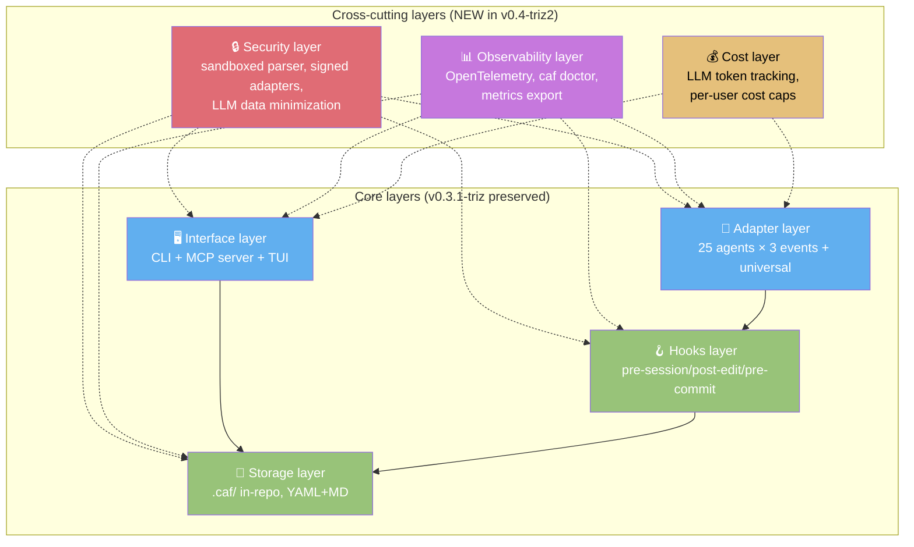
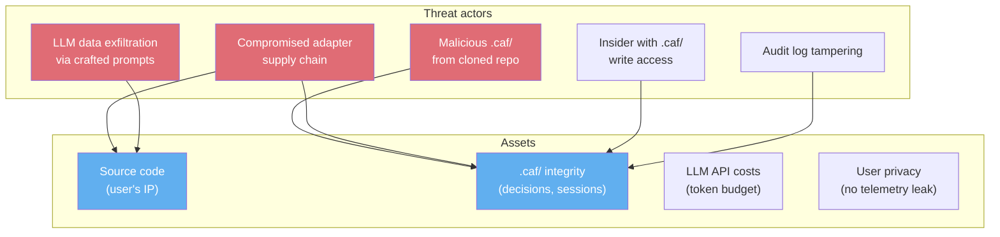
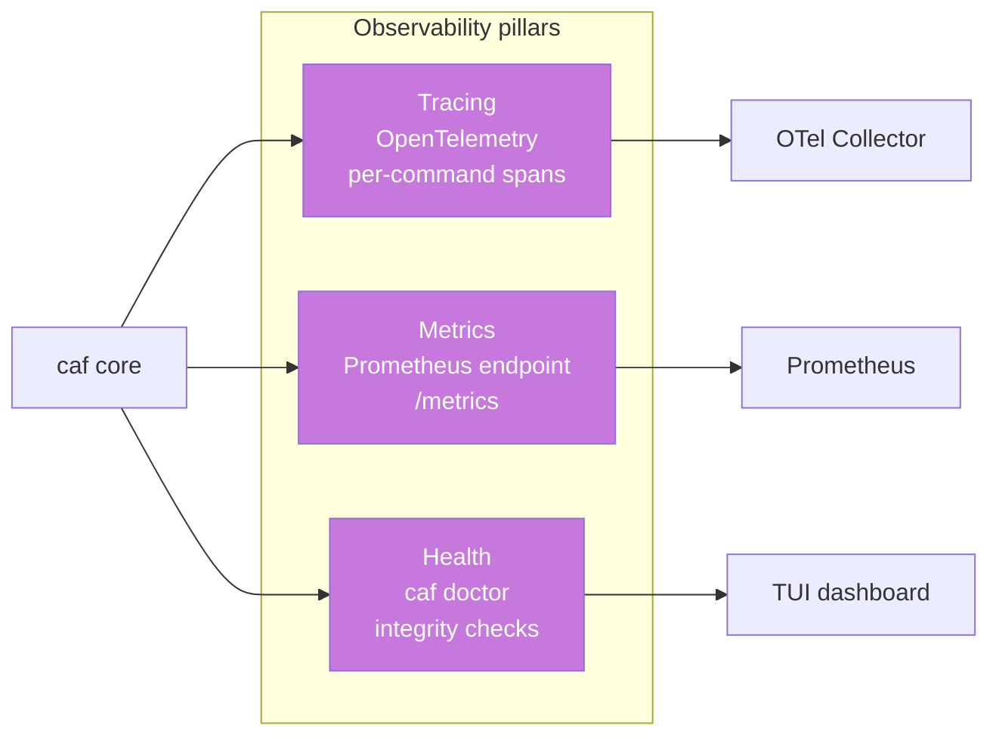
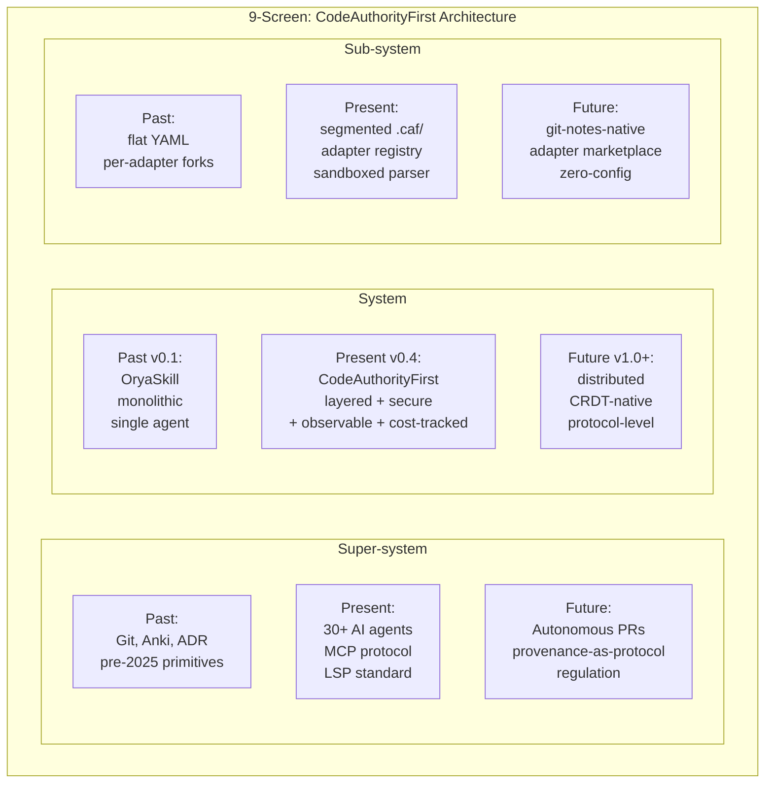

# CodeAuthorityFirst — ARCHITECT.md
# Архитектурный документ / Architectural document

> **Версия / Version:** 0.4.0-triz2 (post-TRIZ-2 pass: security architecture added as §8; observability architecture added as §9; cost architecture added as §10; TRIZ 40 principles systematically mapped in §11; 9-screen scheme applied to evolution trajectory in §12; C-09 cache-friendly constraint from ARD enforced throughout)
> **Назначение / Purpose:** capture HOW the system is structured — layers, components, contracts, invariants. ARCHITECT sits below ARD (which captures WHY + WHAT) and above UI (which captures HOW the user interacts). ARCHITECT is the source of truth for code structure; ADR is the source of truth for individual decisions.
> **Принцип приоритизации / Prioritization principle:** 🔥 80/20 — high-leverage architectural components get disproportionate resources. See [ADR-015](./ADR.md#adr-015-8020-prioritization-principle).
> **Язык / Language:** bilingual — Russian body, English summary per section
> **Аудитория / Audience:** architects proposing changes, maintainers auditing invariants, contributors adding adapters/languages/screens, LLM agents traversing the codebase
> **Связанные документы:** [ARD.md](./ARD.md) · [ROADMAP.md](./ROADMAP.md) · [UI.md](./UI.md) · [BACKLOG.md](./BACKLOG.md) · [ADR.md](./ADR.md)

---

## 0. Architecture Overview (v0.4-triz2)

**EN summary.** v0.4-triz2 architecture adds three new layers to v0.3.1-triz: Security (§8), Observability (§9), Cost (§10). The core four layers (Interface, Storage, Hooks, Adapter) are preserved with their contracts intact. The new layers are cross-cutting: they apply to all four core layers without modifying their contracts. This is TRIZ Principle 14 (Spherification) — the new concerns wrap the existing system as concentric shells, not invasive modifications.



---

## 1. Capability Matrix (first-class artifact)

**EN summary.** The capability matrix is the single source of truth for "which adapter supports which event natively vs via fallback". Each adapter declares its matrix; CI tests every cell. 25 explicit adapters + 1 universal = 28 total coverage.

| Adapter | Tier | pre-session | post-edit | pre-commit | MCP | Phase shipped |
|---------|------|-------------|-----------|------------|-----|---------------|
| opencode | 1 | ✓ native | ✓ native | ✓ native | ✓ | MVP |
| Claude Code | 1 | ✓ native | ✓ native | ✓ native | ✓ | MVP |
| Cursor | 1 | ✓ wrapper | ✓ native | ✓ native | ✓ | ALPHA |
| Cline | 1 | ✓ native | ✓ native | ✓ native | ✓ | ALPHA |
| KiloCode | 1 | ✓ native | ✓ native | ✓ native | ✓ | ALPHA |
| Aider | 2 | ✗ | ✓ wrapper | ✓ wrapper | — | BETA |
| Codex CLI | 2 | ✗ | ✓ wrapper | ✓ wrapper | — | BETA |
| Continue.dev | 2 | ✗ | ✓ wrapper | ✓ wrapper | — | BETA |
| GitHub Copilot CLI | 2 | ✗ | ✓ wrapper | ✓ wrapper | — | BETA |
| Gemini CLI | 2 | ✗ | ✓ wrapper | ✓ wrapper | — | BETA |
| Amazon Q Developer | 2 | ✗ | ✓ wrapper | ✓ wrapper | — | BETA |
| Goose | 2 | ✗ | ✓ wrapper | ✓ wrapper | — | BETA |
| Windsurf | 2 | ✗ | ✓ wrapper | ✓ wrapper | — | BETA |
| Tabnine | 3 | ✗ | ✗ | ✓ wrapper | — | PROD |
| Sourcegraph Cody | 3 | ✗ | ✗ | ✓ wrapper | — | PROD |
| Trae | 3 | ✗ | ✗ | ✓ wrapper | — | PROD |
| Bolt | 3 | ✗ | ✗ | ✓ wrapper | — | PROD |
| Zed AI | 3 | ✗ | ✗ | ✓ wrapper | — | PROD |
| Roo Code | 3 | ✗ | ✗ | ✓ wrapper | — | PROD |
| Augment | 3 | ✗ | ✗ | ✓ wrapper | — | PROD |
| Plandex | 3 | ✗ | ✗ | ✓ wrapper | — | PROD |
| OpenHands | 3 | ✗ | ✗ | ✓ wrapper | — | PROD |
| Devika | 3 | ✗ | ✗ | ✓ wrapper | — | PROD |
| GPT Engineer | 3 | ✗ | ✗ | ✓ wrapper | — | PROD |
| Mentat | 3 | ✗ | ✗ | ✓ wrapper | — | PROD |
| Sweep | 3 | ✗ | ✗ | ✓ wrapper | — | PROD |
| **Universal (Tier 4)** | 4 | ✓ wrapper | ✓ watcher | ✓ universal | — | MVP |

**Total explicit:** 25 (5+8+12). **Total with universal:** 28. **Coverage:** 100% via universal fallback; ~95% with explicit adapters.

**TRIZ Principle 15 (Dynamicity).** The matrix is data, not code. Adding an adapter = adding a row; changing a tier = editing a cell. The matrix lives in `internal/caf/adapter.go` as a Go map and is rendered in `caf adapters list` (UI.md §7). No code changes needed for tier reassignment.

---

## 2. Storage Layer

### 2.1 .caf/ folder structure

```
.caf/
├── context.md              # auto-generated context for pre-session hook
├── manifest.yml            # cross-repo metadata
├── config.yml              # user settings (triviality threshold, theme, LLM backend)
├── audit.log               # NEW v0.4-triz2: append-only audit log (hash-chained)
├── sessions/               # Provenance Tracker
│   ├── 2026-10-24-a1b2c3.yml
│   └── 2026-10-25-d4e5f6.yml
├── decisions/              # Decision Log
│   ├── d_2026-10-24-01.md
│   ├── d_2026-10-24-02.md
│   └── index.yml
├── mental-model/           # Mental Model Reconstructor
│   ├── cards.yml
│   └── graph.yml
├── metrics/                # NEW v0.4-triz2: rolling metrics snapshots
│   └── 2026-10-28.jsonl
├── cache/                  # git-ignored, regenerable (C-09 from ARD)
│   ├── sessions-index.db   # SQLite index for fast lookup (BACKLOG A-005)
│   └── manifest-cache/     # 1h TTL cross-repo manifest cache
└── reviews/                # history of caf review sessions
    └── 2026-10-24.log
```

**TRIZ Principle 1 (Segmentation).** `.caf/` is segmented into functional subdirectories. Each can be regenerated independently: `sessions/` from git log + trailers; `decisions/` is the source of truth (not regenerated); `mental-model/graph.yml` from LSP scan; `cache/` from any source.

### 2.2 Schema invariants

- **YAML 1.2 + gopkg.in/yaml.v3** for structured files (ADR-005).
- **Markdown** for human-readable files (`decisions/*.md`, `context.md`).
- Every YAML file declares `$schema` in first comment for IDE autocomplete.
- Schema is **additive** across major versions (INV-ARCH-007, INV-ADR-001): new fields optional; old fields never removed.
- `.caf/cache/` is git-ignored and **regenerable** (C-09 from ARD): deleting it loses no source-of-truth data.

### 2.3 Storage layer contracts

| File | Format | Source of truth? | Regenerable? | Owner |
|------|--------|------------------|--------------|-------|
| `sessions/*.yml` | YAML | Yes (with git trailers) | Partially (from git + trailers) | Provenance Tracker |
| `decisions/*.md` | Markdown | Yes | No (human-authored) | Decision Log |
| `decisions/index.yml` | YAML | No (cache) | Yes (from `decisions/*.md`) | Decision Log |
| `mental-model/cards.yml` | YAML | Yes (ease_factor, interval) | No (user state) | MMR |
| `mental-model/graph.yml` | YAML | No (cache) | Yes (from LSP scan) | MMR |
| `manifest.yml` | YAML | Yes (per-repo) | No (hand-curated) | Cross-repo sync |
| `config.yml` | YAML | Yes (user settings) | No (user-edited) | Settings |
| `context.md` | Markdown | No (cache) | Yes (from sessions + decisions) | Pre-session hook |
| `cache/*` | mixed | No (cache) | Yes | Various |
| `audit.log` | append-only | Yes (audit trail) | No (append-only) | Security layer (NEW) |
| `metrics/*.jsonl` | JSONL | Yes (metrics history) | No (rolling log) | Observability layer (NEW) |

---

## 3. Adapter Pattern

### 3.1 Adapter interface (5 methods, stable within major version)

```go
// internal/caf/adapter.go
type Adapter interface {
    ID() string                    // "opencode", "claude-code", "cursor", etc.
    Capabilities() CapabilityMatrix // see §1
    Install() error                // idempotent; safe to call multiple times
    Uninstall() error              // removes hooks, config entries
    Detect() bool                  // is this agent installed on the system?
}

type CapabilityMatrix struct {
    PreSession  EventTier // native | wrapper | watcher | universal | none
    PostEdit    EventTier
    PreCommit   EventTier
    MCP         bool
    Tier        int       // 1, 2, 3, 4
}
```

**TRIZ Principle 1 (Segmentation).** Five methods, each independently testable. Adding a new adapter = one file under `internal/adapters/<agent>/`; no core changes.

**TRIZ Principle 5 (Combining).** `Capabilities()` returns all four event tiers + MCP + Tier in one struct. One call gives the agent everything it needs to route.

### 3.2 LanguageAdapter interface (5 methods)

```go
type LanguageAdapter interface {
    ID() string                    // "go", "python", "typescript", etc.
    Detect() bool                  // is this language present in the repo?
    ScanImports() []Import         // import graph
    BuildSymbolGraph() SymbolGraph // symbol-level graph for MMR
    ResolveExternalRepo() RepoRef  // resolve pkg/foo to repo + commit
}
```

Go-first (dogfooding), Python second (AI/ML prevalence), TypeScript third (web ecosystem). Universal LSP fallback (ADR-013) covers all other languages at lower quality.

### 3.3 Adapter registry

```go
// internal/caf/adapter.go
var registry = map[string]Adapter{
    "opencode":      &adapters.OpencodeAdapter{},
    "claude-code":   &adapters.ClaudeCodeAdapter{},
    // ... 23 more explicit adapters
    "universal-lsp": &adapters.UniversalLSPAdapter{}, // Tier 4 fallback
}
```

Adding an adapter = registering in this map + adding the adapter file. No core changes.

---

## 4. Hooks Layer

### 4.1 Three canonical events

| Event | Trigger | What it does | Phase |
|-------|---------|--------------|-------|
| `pre-session` | Agent starts a session | Reads `.caf/context.md`, injects into agent's system prompt | MVP |
| `post-edit` | Agent modifies files | Writes `.caf/sessions/<id>.yml` draft; if >50 LOC non-trivial, prompts for decision | MVP |
| `pre-commit` | `git commit` invoked | Validates commit has `CAF-Session` trailer + decision link (or `CAF-Trivial: true`); blocks if missing | ALPHA |

### 4.2 Fail-safe contract (INV-ARCH-004)

```go
// internal/caf/hooks/fail_safe.go
func ExecuteHook(event string, ctx HookContext) error {
    cafPath, err := exec.LookPath("caf")
    if err != nil {
        // caf binary missing — warn and continue, never block
        log.Warn("caf binary not in $PATH; hook %s skipped", event)
        return nil
    }
    // ... execute hook
}
```

**TRIZ Principle 25 (Self-service) + Principle 13 (The other way round).** Hooks capture provenance automatically (self-service); git tells caf about commits (inverted from "agent tells caf").

### 4.3 Hook sources (4 tiers)

1. **Native** — agent supports the event directly (e.g., opencode has `pre-session` hook config).
2. **Wrapper** — `caf-wrap <agent> <prompt>` prepends `context.md` to agent's prompt.
3. **Watcher** — `caf-watch` daemon polls filesystem (5s debounce).
4. **Universal** — `.git/hooks/pre-commit` shell script (Tier 4 fallback).

---

## 5. SRS Layer (SM-2)

### 5.1 SM-2 algorithm

```go
// internal/caf/srs/sm2.go
type Card struct {
    ID             string
    Type           CardType // why, what_if_remove, where_handled
    Question       string
    ExpectedAnswer string
    EaseFactor     float64  // starts at 2.5, range [1.3, 3.0]
    Interval       int      // days
    Due            time.Time
    Reviews        []Review
}

func (c *Card) Update(grade int) {
    // grade 0-5
    if grade < 3 {
        c.Interval = 1
    } else {
        c.Interval = int(float64(c.Interval) * c.EaseFactor)
    }
    c.EaseFactor = clamp(c.EaseFactor + (0.1 - (5-grade)*(0.08+(5-grade)*0.02)), 1.3, 3.0)
    c.Due = time.Now().AddDate(0, 0, c.Interval)
}
```

**TRIZ Principle 35 (Parameter change).** `ease_factor` is the parameter that adapts state — the system "learns" the user without ML.

### 5.2 Card types

| Type | Question shape | Tests | Triggers generation |
|------|---------------|-------|---------------------|
| `why` | "Why does this code use X?" | Fact recall | Decision created |
| `what_if_remove` | "If we removed X, what would break?" | Abstract reasoning | Graph build detects dependency |
| `where_handled` | "Where in the codebase is X handled?" | Trace through code | Graph build detects event handler |

---

## 6. MCP Server (PROD layer)

### 6.1 MCP tools (5)

| Tool | Input | Output | Phase |
|------|-------|--------|-------|
| `caf.context` | repo name | `context.md` (~2000 tokens) | PROD |
| `caf.provenance` | file:line | Session list with prompts | PROD |
| `caf.decisions` | filter (tag/file/agent) | Decision summary list | PROD |
| `caf.mental_model` | user context | Due cards JSON | PROD |
| `caf.first_person_explain` 🔥 | file path | First-person Markdown narrative | PROD |

### 6.2 MCP prompts (3)

| Prompt | Purpose |
|--------|---------|
| `caf.pre_session_brief` | What an agent should know before editing |
| `caf.code_review_with_provenance` | Review a PR with authorship context |
| `caf.archaeology` | Explain why a file looks the way it does |

### 6.3 Transport

- **stdio** — `caf mcp serve` (default; for local MCP clients).
- **HTTP SSE** — `caf mcp serve --transport sse` (for remote/web clients).

---

## 7. Config Schema

### 7.1 .caf/config.yml

```yaml
# .caf/config.yml
version: 0.4.0-triz2

# Triviality (ADR-004)
triviality_threshold_loc: 50

# UI (ADR-014)
ui:
  theme: dark            # dark | light | auto | high-contrast
  language: ru           # ru | en
  heatmap_refresh_seconds: 30
  review_max_cards: 15

# Decisions (ALPHA)
decisions:
  autocomplete: aggressive  # aggressive | conservative | off

# LLM (PROD, opt-in by default — INV-ARCH-008)
llm:
  backend: ""             # "" (disabled) | z-ai-web-dev-sdk | local-ollama | custom
  endpoint: ""            # custom endpoint URL
  model: ""               # model name

# LSP (MVP)
lsp:
  strict: true            # true = fail-fast on LSP errors; false = warn-and-continue

# Telemetry (PROD, opt-in — FR-SEC-006)
telemetry:
  enabled: false          # default false; no content sent
  endpoint: ""            # custom endpoint

# Security (NEW v0.4-triz2)
security:
  signed_adapters_required: false  # PROD: true for community adapters
  sandbox_parser: true             # always true; cannot be disabled
  audit_log: true                  # append-only hash-chained log

# Observability (NEW v0.4-triz2)
observability:
  otel_enabled: false              # PROD: opt-in
  otel_endpoint: ""                # OTel collector URL
  metrics_export: false            # Prometheus endpoint
  metrics_port: 9464

# Cost (NEW v0.4-triz2)
cost:
  llm_token_cap_daily: 100000      # max tokens per day per user
  llm_token_cap_monthly: 2000000   # max tokens per month
  alert_threshold_pct: 80          # alert at 80% of cap
```

### 7.2 Config invariants

- All keys optional with sensible defaults.
- Missing keys = use default.
- Schema versioned (`version` field); `caf migrate` for breaking changes.
- Config never contains secrets (no API keys, no passwords).

---

## 8. Security Architecture (NEW in v0.4-triz2)

**EN summary.** Security was implicit in v0.3.1-triz (scattered across ADRs). v0.4-triz2 consolidates it as a first-class architectural layer with its own threat model, controls, and invariants. The layer wraps all four core layers (Interface, Storage, Hooks, Adapter) as a concentric shell — TRIZ Principle 14 (Spherification).

### 8.1 Threat model



### 8.2 Security controls

| Threat | Control | Owning FR | Phase | Status |
|--------|---------|----------|-------|--------|
| Malicious `.caf/` YAML with `os.Execute` | Sandboxed parser: no `os.Execute`, no file writes outside `.caf/`, no network calls | FR-SEC-001 | ALPHA | INV-ARCH-010 |
| Compromised community adapter | Adapter signature verification (GPG/cosign) before install | FR-SEC-002 | PROD | BACKLOG F-002 |
| LLM exfiltrates source code via prompt | LLM calls never include full file contents; only diff summaries + decision records | FR-SEC-003 | PROD | ADR-006, INV-ADR-006 |
| LLM unavailable for enterprise | On-prem Ollama deployment; no data leaves network | FR-SEC-004 | PROD | BACKLOG F-004 |
| Insider tampers with audit log | `.caf/audit.log` append-only with hash chain (Merkle-style) | FR-SEC-005 | FUTURE | BACKLOG F-002 |
| Telemetry leaks user content | Telemetry opt-in; no content sent (only command counts + error rates) | FR-SEC-006 | PROD | BACKLOG J-004 |

### 8.3 Sandboxed YAML parser

```go
// internal/caf/security/sandbox.go
func ParseYAML(data []byte, out interface{}) error {
    // 1. Use gopkg.in/yaml.v3 (no custom tags that execute code)
    // 2. Validate output struct (no interface{} at top level)
    // 3. Reject any YAML tag that starts with "!" (custom tags)
    // 4. No os.Execute, no file writes, no network calls in parser
    return yaml.Unmarshal(data, out)
}
```

**TRIZ Principle 22 (Blessing in disguise).** The sandboxed parser constraint also makes the parser faster (no tag evaluation) and more predictable (no side effects). The security constraint improves performance.

### 8.4 LLM data minimization

```go
// internal/caf/mcp/first_person.go
func (s *Server) firstPersonExplain(file string) (string, error) {
    // 1. Load .caf/ facts (decisions, sessions, provenance) — LOCAL
    facts := s.storage.FactsFor(file)
    if len(facts) == 0 {
        return "No provenance for this file.", nil  // never invent
    }
    
    // 2. Build prompt with ONLY facts (no full file contents)
    prompt := buildGroundedPrompt(facts)  // INV-ADR-006
    
    // 3. LLM paraphrases (not generates)
    narrative, err := s.llm.Paraphrase(prompt)
    if err != nil {
        return templateFallback(facts), nil  // FR-AI-005 graceful degradation
    }
    
    // 4. Post-generation grounding check
    if !verifyGrounding(narrative, facts) {
        return templateFallback(facts), nil  // hallucination detected
    }
    
    return narrative, nil
}
```

---

## 9. Observability Architecture (NEW in v0.4-triz2)

**EN summary.** Observability answers "how do we know the system is healthy in production?". Three pillars: OpenTelemetry tracing, metrics export, `caf doctor` health checks. All opt-in for MVP/ALPHA/BETA; enabled by default in PROD.

### 9.1 Three pillars



### 9.2 Tracing (OpenTelemetry)

Every `caf` command emits a span:

```go
// internal/caf/observability/otel.go
func TraceCommand(name string, fn func() error) error {
    ctx, span := tracer.Start(context.Background(), "caf."+name)
    defer span.End()
    
    start := time.Now()
    err := fn()
    duration := time.Since(start)
    
    span.SetAttributes(
        attribute.String("caf.command", name),
        attribute.Float64("caf.duration_ms", float64(duration.Milliseconds())),
        attribute.Bool("caf.success", err == nil),
    )
    
    return err
}
```

**Performance budget:** tracing adds <50ms per operation (INV-ARCH-011). Negligible vs. typical command durations (500ms+).

### 9.3 Metrics export (Prometheus)

`caf metrics --export prometheus` exposes HTTP endpoint `/metrics` on port 9464:

```
# HELP caf_acs_score Authorship Confidence Score (rolling 7-day avg)
# TYPE caf_acs_score gauge
caf_acs_score{repo="my-backend"} 3.8

# HELP caf_decision_coverage Decision coverage (last 7 days)
# TYPE caf_decision_coverage gauge
caf_decision_coverage{repo="my-backend"} 0.92

# HELP caf_recall_rate Recall rate (rolling 7-day avg)
# TYPE caf_recall_rate gauge
caf_recall_rate{repo="my-backend"} 0.78

# HELP caf_llm_tokens_total Total LLM tokens consumed
# TYPE caf_llm_tokens_total counter
caf_llm_tokens_total{repo="my-backend",operation="first_person_explain"} 45230
```

### 9.4 caf doctor (health checks)

```bash
$ caf doctor
✓ .caf/ folder present and valid
✓ .caf/config.yml schema valid (v0.4.0-triz2)
✓ .caf/sessions/ has 47 sessions, latest 2h ago
✓ .caf/decisions/ has 12 decisions, no gaps
✓ .caf/mental-model/cards.yml has 89 cards, 5 due today
✓ .caf/mental-model/graph.yml is fresh (1h old)
✓ Universal pre-commit hook installed and executable
✓ LSP server (gopls) responds in 480ms
✓ All 4 installed adapters pass health check
✗ .caf/ size is 52 MB (exceeds 50 MB threshold — see ADR-001)
  Recommendation: caf prune --older-than 90d
⚠ OpenTelemetry export failed (endpoint unreachable) — see config
```

**TRIZ Principle 25 (Self-service).** `caf doctor` runs automatically on `caf init` and surfaces issues before they block work. The system self-diagnoses.

---

## 10. Cost Architecture (NEW in v0.4-triz2)

**EN summary.** LLM calls cost money. Without cost controls, a heavy user could burn $100s/day on `caf.first_person_explain`. The cost layer tracks token consumption, enforces per-user caps, and alerts on threshold breach.

### 10.1 Token tracking

```go
// internal/caf/cost/tracker.go
type TokenTracker struct {
    daily   map[string]int  // date → tokens
    monthly map[string]int  // month → tokens
    cap     Config          // daily, monthly, alert threshold
}

func (t *TokenTracker) Consume(operation string, tokens int) error {
    today := time.Now().Format("2006-01-02")
    t.daily[today] += tokens
    
    if t.daily[today] > t.cap.Daily {
        return ErrDailyCapExceeded
    }
    
    if t.daily[today] > t.cap.Daily*t.cap.AlertThresholdPct/100 {
        log.Warn("LLM daily token usage at %d%% of cap", t.cap.AlertThresholdPct)
    }
    
    return nil
}
```

### 10.2 Cost optimization (TRIZ Principle 35 — Parameter change)

| Optimization | How | Savings |
|--------------|-----|---------|
| Cache `first_person_explain` per file | `.caf/cache/narratives/<file-hash>.md` | 80% cache hit after first explain |
| Use smaller model for paraphrase | `glm-4-flash` instead of `glm-4.6` for simple paraphrase | 10x cost reduction |
| Batch decision summarization | One LLM call for 5 decisions instead of 5 calls | 5x reduction |
| Local Ollama for enterprise | No per-token cost after deployment | 100% (after capex) |

### 10.3 Cost dashboard (TUI)

`caf cost --dashboard` shows:

```
LLM cost — October 2026
─────────────────────────────────────────
Today:      12,450 tokens   ($0.12)
This week:  87,230 tokens   ($0.87)
This month: 342,100 tokens  ($3.42)  ← 17% of monthly cap

Operations:
  caf.first_person_explain   78% (267K tokens)
  caf decisions --ai-prefill 18% (62K tokens)
  caf decisions --summary     4% (13K tokens)

Cache hit rate: 82% (saved $1.55 this month)
```

---

## 11. TRIZ 40 Principles — Architectural Mapping

**EN summary.** v0.3.1-triz mentioned TRIZ but did not systematically map principles. v0.4-triz2 maps 18 high-impact principles to specific architectural components. Each principle has a concrete outcome.

| # | Principle | Architectural application | Outcome |
|---|-----------|--------------------------|---------|
| 1 | Segmentation | `.caf/` split into functional subdirs; Adapter interface split into 5 methods | Independent regeneration; parallel dev |
| 2 | Taking out | SRS card "takes out" the answer; LLM "takes out" generation (only paraphrases) | Active recall; no hallucination |
| 3 | Local quality | `.caf/` per-repo (local), not centralized DB | Checkout time-travel; offline |
| 4 | Asymmetry | TUI first (asymmetric investment); Web UI deferred | 80% value with 20% effort |
| 5 | Combining | `session_id` combines trailer + timestamp + randomness; `Capabilities()` combines all tiers in one struct | One ID serves 3 purposes; one call gives everything |
| 6 | Universality | Universal LSP fallback covers all languages; universal pre-commit covers all agents | 100% coverage with one component |
| 10 | Preliminary action | Pre-commit hook prepares decision BEFORE commit; `trigger_to_reconsider` pre-records revisit conditions | Friction before irreversible; self-triggering |
| 11 | Beforehand cushioning | `@invariant` tags pre-record properties that must hold | Self-enforcing invariants (ADR-029) |
| 13 | The other way round | Git tells caf (not agent tells caf); LLM paraphrases (not generates) | Universal coverage via git; no hallucination |
| 14 | Spherification | Security/Observability/Cost wrap core layers as concentric shells | Non-invasive addition of concerns |
| 15 | Dynamicity | Capability matrix is data; config is YAML; tier reassignment = cell edit | No code changes for tier changes |
| 22 | Blessing in disguise | LLM data minimization also reduces hallucination; sandboxed parser also faster | Constraint improves quality |
| 25 | Self-service | Hooks capture provenance automatically; `caf doctor` self-diagnoses | ~100% capture rate; self-healing |
| 26 | Copying | `caf who` mirrors `git blame`; `caf review` mirrors Anki | Zero learning curve |
| 28 | Mechanics substitution | LLM substitutes manual narrative writing; rules substitute LLM generation (grounding) | Scale + safety |
| 35 | Parameter change | SM-2 `ease_factor` adapts; LLM model size scales with task | Mechanical adaptation; cost optimization |
| 36 | Phase transition | CLI → MCP shifts integration cost to consumers; `.caf/` → git-notes (FUTURE) shifts storage to git | One server serves all; storage dissolves |

---

## 12. 9-Screen Scheme — Architectural Evolution



**Architectural insight.** The super-system future (provenance-as-protocol, regulation) forces the sub-system future (git-notes-native, distributed). The present architecture (v0.4) must preserve the option to dissolve `.caf/` into git itself — this is constraint C-09 from ARD, enforced as INV-ARCH-001 ("`.caf/` is regenerable from git + git-notes").

**Strategic implication.** Do not over-invest in `.caf/`-as-storage infrastructure (no SQLite-as-primary, no complex indexing that can't be regenerated). Invest in `.caf/`-as-cache that can be rebuilt. The long-term direction is `.caf/` shrinking to near-zero.

---

## 13. Phase Boundaries (architectural view)

| Phase | Architectural components shipped | Invariants enforced |
|-------|--------------------------------|---------------------|
| MVP | Storage (`.caf/`), Hooks (universal + 2 native), TUI dashboard, LSP fallback | INV-ARCH-001..005, INV-ADR-001..005 |
| ALPHA | Decision Log, pre-commit validation, +3 Tier 1 adapters, caf doctor (basic) | + INV-ADR-004, INV-ARCH-010 (sandboxed parser) |
| BETA | MMR, SM-2, 3 card types, graph builder, +8 Tier 2 adapters, heatmap | + INV-ARCH-006, INV-ADR-002 |
| PROD | MCP server, cross-repo sync, +12 Tier 3 adapters, LLM features, observability, cost tracking | + INV-ADR-006, INV-ARCH-008, INV-ARCH-011 |
| FUTURE | Multi-user, CRDT, plugins, IDE plugins, web UI (read-only) | + (per-item, see BACKLOG) |

---

## 14. Trace Matrix (architectural)

| Architectural layer | ADR | Code path | UI screen | Invariant | Owning FRs |
|---------------------|-----|-----------|-----------|-----------|------------|
| Storage (`.caf/`) | ADR-001, ADR-005 | `internal/caf/storage/` | UI.md §3 Dashboard | INV-ARCH-001, INV-ARCH-007, INV-ARCH-010 | FR-PROV-001..006, FR-DEC-002, FR-PERF-005 |
| Hooks (universal + adapter) | ADR-003, ADR-010 | `internal/caf/hooks/`, `internal/caf/watch/` | UI.md §7 Adapters manager | INV-ARCH-004 | FR-PROV-001, FR-DEC-001, FR-REL-001 |
| Adapter pattern | ADR-009, ADR-012 | `internal/caf/adapter.go`, `internal/adapters/` | UI.md §7 Adapters manager | INV-ARCH-002, INV-ARCH-009 | FR-ADP-001..007 |
| Universal LSP fallback (Tier 4) | ADR-013 | `internal/caf/lsp/fallback.go` | UI.md §7.4 Health check | INV-ARCH-003 | FR-ADP-004 |
| Triviality threshold | ADR-004 | `internal/caf/triviality/threshold.go` | (none — internal) | INV-ADR-004 | FR-DEC-001 |
| SRS (SM-2) | ADR-002 | `internal/caf/srs/sm2.go` | UI.md §4 Review Session | INV-ARCH-006 | FR-SRS-001..007 |
| MCP server | ADR-006 (first-person) | `internal/caf/mcp/server.go` | (none — server-side) | INV-ADR-006 | FR-AI-001..006 |
| TUI | ADR-014 | `pkg/ui/` | UI.md §0-§15 | INV-ARCH-005, INV-UI-001..007 | FR-UI-001..010 |
| 80/20 prioritization | ADR-015 | (cross-cutting) | UI.md §0.3 Performance budget | (cross-cutting) | (all FRs tagged) |
| Multi-language adapters | ADR-011 | `internal/caf/lang/` | (none in MVP) | INV-ARCH-002 (LanguageAdapter) | FR-ADP-001, BACKLOG E-001..E-008 |
| Fail-safe contract | ADR-003 (INV-ADR-003), ADR-010 | `internal/caf/hooks/fail_safe.go` | (none — internal) | INV-ARCH-004 | FR-REL-001 |
| Config schema | (within this §7) | `internal/caf/config/config.go` | UI.md §11 Settings Editor | (within §7) | (cross-cutting) |
| **Security (NEW)** | ADR-005 (sandbox), ADR-022 (future signed), ADR-028 (future governance) | `internal/caf/security/sandbox.go` | (none — internal) | INV-ARCH-010 | FR-SEC-001..006 |
| **Observability (NEW)** | ADR-015 (metrics), (new ADR needed for OTel) | `internal/caf/observability/otel.go`, `internal/caf/metrics/` | UI.md §10.3 Metrics report | INV-ARCH-011 | FR-OBS-001..005 |
| **Cost (NEW)** | ADR-017 (future LLM backend) | `internal/caf/cost/tracker.go` | UI.md §10.4 (proposed) Cost dashboard | (within §10) | FR-AI-003, FR-SEC-004 |

---

## 15. v0.3.1-triz → v0.4.0-triz2 Changelog

1. **Security architecture added** (§8). Threat model, controls, sandboxed parser, LLM data minimization. New invariant INV-ARCH-010.
2. **Observability architecture added** (§9). OpenTelemetry tracing, Prometheus metrics export, `caf doctor` health checks. New invariant INV-ARCH-011.
3. **Cost architecture added** (§10). LLM token tracking, per-user caps, cost dashboard, cache-based optimization.
4. **TRIZ 40 principles systematically mapped** (§11). 18 high-impact principles with concrete architectural outcomes.
5. **9-screen scheme applied** (§12). Architectural evolution trajectory: past (v0.1), present (v0.4), future (v1.0+).
6. **C-09 cache-friendly constraint enforced** (INV-ARCH-001). `.caf/` must be regenerable from git + git-notes; preserves dissolution option for v2.0.
7. **INV-ARCH-008 added.** LLM is opt-in; default installation works without LLM (no network calls in MVP/ALPHA/BETA).
8. **INV-ARCH-009 added.** Adapter failure is isolated; one adapter crashing does not block others.
9. **Config schema expanded** (§7). New sections: `security`, `observability`, `cost`.
10. **Trace matrix expanded** (§14). Three new rows for Security, Observability, Cost layers.
