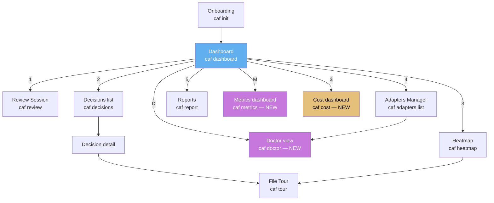

# CodeAuthorityFirst — UI.md
# Документ пользовательского интерфейса / UI specification

> **Версия / Version:** 0.4.0-triz2 (post-TRIZ-2 pass: 3 new screens added — Metrics dashboard §13, Cost dashboard §14, Doctor view §15; accessibility audit added as §16 with WCAG-equivalent for terminal; screen template formalized in §0.7; UI-velocity patterns expanded with 4th pattern — Progressive enhancement analogue)
> **Назначение / Purpose:** detailed specification of all user-facing interfaces — primarily TUI (terminal UI), with progressive enhancements for IDE plugins and (future) web UI. Every screen has ASCII mockup, keyboard map, performance budget, and edge cases.
> **Философия / Philosophy:** TUI-first (🔥 80/20), sub-100ms response, keyboard-only operation possible, lazy rendering for large datasets, accessibility by design. Four UI-velocity patterns (originally from web) are implemented as native TUI patterns: Critical CSS analogue, Islands/partial hydration analogue, Skeleton/SWR analogue, Progressive enhancement analogue (NEW v0.4-triz2).
> **Язык / Language:** bilingual — Russian body, English summary per section
> **Аудитория / Audience:** UI/UX implementers, contributors adding TUI screens, design reviewers, accessibility auditors, LLM agents reasoning about UI velocity budgets
> **Связанные документы:** [ARD.md](./ARD.md) · [ARCHITECT.md](./ARCHITECT.md) · [ROADMAP.md](./ROADMAP.md) · [BACKLOG.md](./BACKLOG.md) · [ADR.md](./ADR.md)

---

## 0. UI Philosophy & Stack

### 0.1 Why TUI-first (🔥 80/20)

**EN summary.** TUI-first covers 80% of use cases with 20% of effort. Terminal apps start in <50ms; web apps need server + bundle. SSH/Docker/CI all have terminals, none have browsers. Keyboard-native aligns with vim/Emacs users. No Node.js, no browser, no Electron — single Go binary.

TUI-first — архитектурное решение (ADR-014), не fallback. Шесть причин:

1. **🔥 80/20.** TUI покрывает 80% UX use cases 20% effort. Web UI — отложен до FUTURE.
2. **Скорость.** Terminal apps start in <50ms. Web apps 500-2000ms.
3. **Универсальность.** SSH, Docker, CI — везде есть terminal, нигде нет browser.
4. **Keyboard-native.** Developers know vim. `?` for help is universal.
5. **No deps.** Single Go binary. No Node.js, no browser, no Electron.
6. **Accessibility by default (NEW v0.4-triz2).** TUI is screen-reader friendly (text output); keyboard-only is the natural mode; high-contrast is a config flag, not an afterthought.

| Критерий | TUI | Web UI |
|----------|-----|--------|
| Time-to-first-paint | <100ms | 500-2000ms |
| Distribution | Single binary (~10 MB) | Server + bundle (~5 MB JS) |
| SSH/Docker/CI | ✓ universal | ✗ requires port-forward |
| Keyboard-first | ✓ native | requires tab-trapping JS |
| Maintenance cost | 1 stack (Go + Bubble Tea) | 2 stacks (Go + Node + browser quirks) |
| Screen reader support | ✓ (text output) | requires ARIA |
| Coverage | 80% use cases | 95% use cases |

### 0.2 TUI stack

| Component | Choice | Reason |
|-----------|--------|--------|
| Framework | [Bubble Tea](https://github.com/charmbracelet/bubbletea) | ELM architecture (Model-Update-View), `tea.Cmd` for async, mature |
| Styling | [Lipgloss](https://github.com/charmbracelet/lipgloss) | Style strings pre-computed at startup; **Critical CSS analogue** |
| List virtualization | [Bubbles list](https://github.com/charmbracelet/bubbles) | Handles >1000 items with viewport virtualization |
| Markdown | [Glamour](https://github.com/charmbracelet/glamour) | Renders decision records, README, ADRs in TUI |
| Progress bars | Bubbles spinner, progress | Standard component |
| Input fields | Bubbles textinput, textarea | Standard components |
| Tables | Bubbles table | Sortable, paginated |
| Color detection | [termenv](https://github.com/muesli/termenv) | Auto-detects 256/truecolor, falls back to 16-color |

### 0.3 Performance budget (universal)

| Operation | Budget | Strategy | Invariant |
|-----------|--------|----------|-----------|
| First paint (any screen) | <100ms | Render skeleton first, lazy-load data | INV-UI-001 |
| Frame render (scroll, redraw) | <16ms (60fps) | Virtualized lists, cached layouts | INV-UI-002 |
| Keystroke response | <50ms | Direct dispatch, no async for simple actions | INV-UI-003 |
| LLM-dependent operations | <3s (acceptable) | Skeleton + spinner, cache results | (INV-UI-004 SWR pattern) |
| File operations on 10k-file repo | <1s | Streaming + index, no full load | (INV-ARCH-003 LSP fallback) |
| **Doctor run (11 checks) (NEW v0.4-triz2)** | **<5s** | **Parallel goroutines where possible** | **(INV-ARCH-011 OTel overhead)** |
| **Metrics dashboard load (NEW v0.4-triz2)** | **<500ms** | **Rolling log aggregation, cached** | **(INV-UI-004 SWR)** |
| **Cost dashboard load (NEW v0.4-triz2)** | **<300ms** | **Token aggregation, cached** | **(INV-UI-004 SWR)** |

### 0.4 Color system

```go
// pkg/ui/theme.go
var (
    Primary    = lipgloss.Color("#61AFEF") // blue — primary actions, headings
    Secondary  = lipgloss.Color("#98C379") // green — success, owned files
    Warning    = lipgloss.Color("#E5C07B") // yellow — warnings, pending decisions
    Error      = lipgloss.Color("#E06C75") // red — errors, blindspots
    Muted      = lipgloss.Color("#5C6370") // gray — muted text, meta
    Accent     = lipgloss.Color("#C678DD") // purple — accent, LLM-related
    Background = lipgloss.Color("#282C34") // dark — app background
)
```

Fallback (16-color): Primary→blue, Secondary→green, Warning→yellow, Error→red, Muted→white(dim), Accent→magenta, Background→black. termenv handles detection at startup.

**High-contrast mode (NEW v0.4-triz2):** `caf config set ui.theme high-contrast` swaps to WCAG-AAA contrast palette: Primary→#FFFFFF on black, Error→#FFFF00 on black, etc. For users with low vision.

### 0.5 Typography

| Element | Style | Example |
|---------|-------|---------|
| H1 (screen title) | Bold + Accent color | `# CodeAuthorityFirst — Dashboard` |
| H2 (section) | Bold + Primary color | `## Today` |
| H3 (subsection) | Bold + Primary color | `### Review queue` |
| Body | Regular + Text color | `5 cards due, 2 pending decisions` |
| Muted meta | Muted color, smaller | `Last refresh: 30s ago` |
| Code | SarasaMonoSC | `caf who internal/middleware/ratelimit.go:42` |
| Error | Error color + Bold | `Error: caf binary missing. Sessions continue.` |

### 0.6 Universal keyboard map (updated v0.4-triz2)

| Key | Action | Works in |
|-----|--------|----------|
| `?` | Help overlay | All screens |
| `q` / `Ctrl+C` | Quit | All screens |
| `Esc` | Back / Cancel | All screens |
| `Tab` / `Shift+Tab` | Cycle widgets / focus | Dashboard, multi-panel screens |
| `j` / `↓` | Down | Lists, tables, single-panel |
| `k` / `↑` | Up | Lists, tables, single-panel |
| `g` | Top | Lists, tables |
| `G` | Bottom | Lists, tables |
| `/` | Search | Lists, tables, decisions |
| `Enter` | Activate | Lists, tables, cards |
| `Space` | Toggle | Checkboxes, card selection |
| `r` | Refresh | Dashboard, decisions, adapters |
| `1`-`9` | Switch screen | Dashboard, navigation |
| `:` | Command palette | All screens (FUTURE K-010) |
| `h` / `l` | Left / Right nav | Multi-panel: review, file tour |
| **`D` (NEW v0.4-triz2)** | **Doctor view** | **All screens (global shortcut)** |
| **`M` (NEW v0.4-triz2)** | **Metrics dashboard** | **All screens (global shortcut)** |
| **`$` (NEW v0.4-triz2)** | **Cost dashboard** | **All screens (global shortcut)** |

### 0.7 Screen template (formalized v0.4-triz2)

Every screen in `pkg/ui/screens/` follows this template:

```go
// pkg/ui/screens/<name>.go
// §<N> <Title> (caf <command>)
//
// Purpose: <one sentence>
// Layout: <ASCII mockup reference>
// Components: <list>
// Keyboard map: <table>
// Performance budget: <table>
// Edge cases: <list>
// Accessibility: <a11y notes — NEW v0.4-triz2>

package screens

type <Name>Screen struct {
    // ... state
}

func (s *<Name>Screen) Init() tea.Cmd { /* ... */ }
func (s *<Name>Screen) Update(msg tea.Msg) (tea.Model, tea.Cmd) { /* ... */ }
func (s *<Name>Screen) View() string { /* ... */ }
```

**TRIZ Principle 1 (Segmentation) + Principle 26 (Copying).** Each screen is segmented into a separate file following a copied template. New screen = new file + template fill; no core changes.

### 0.8 UI-velocity patterns (4 patterns, expanded v0.4-triz2)

**EN summary.** v0.3.1-triz documented 3 UI-velocity patterns (Critical CSS, Islands, Skeleton/SWR analogues). v0.4.0-triz2 adds a 4th: Progressive enhancement analogue — the TUI works in 16-color mode, then enhances to 256-color, then to truecolor, based on terminal capability. This is the same shape as web progressive enhancement (HTML works without CSS, then enhances with CSS, then with JS).

1. **Critical CSS analogue → Lipgloss pre-computed styles.** (INV-UI-006)
2. **Islands / partial hydration analogue → Lazy screen mount.** (INV-UI-005)
3. **Skeleton / stale-while-revalidate analogue → Skeleton{} + DataLoadedMsg swap.** (INV-UI-004)
4. **Progressive enhancement analogue (NEW v0.4-triz2) → termenv color detection.** TUI works in 16-color mode (basic), enhances to 256-color (better), enhances to truecolor (best). Each level is functional; the higher levels add polish, not capability. This is structurally the same as web progressive enhancement: HTML works without CSS, then CSS enhances, then JS enhances.

---

## 1. Screens Overview (updated v0.4-triz2)

### 1.1 Screen inventory

| # | Screen | Command | Phase | Spec section |
|---|--------|---------|-------|--------------|
| 1 | Onboarding Wizard | `caf init` | MVP | §2 |
| 2 | Dashboard | `caf dashboard` | MVP | §3 |
| 3 | Review Session | `caf review` | BETA | §4 |
| 4 | Decisions list | `caf decisions` | ALPHA | §5.1 |
| 5 | Decision detail | (from list) | ALPHA | §5.2 |
| 6 | Decision editor | `caf decisions new` | ALPHA | §5.3 |
| 7 | Heatmap | `caf heatmap` | BETA | §6 |
| 8 | Adapters Manager | `caf adapters list` | MVP | §7 |
| 9 | File Tour | `caf tour <file>` | BETA | §8 |
| 10 | Sessions browser | `caf sessions` | ALPHA | (future §) |
| 11 | Reports | `caf report` | PROD | §10 |
| 12 | Settings | `caf config edit` | ALPHA | §11 |
| **13 (NEW)** | **Metrics dashboard** | **`caf metrics --dashboard`** | **PROD** | **§13** |
| **14 (NEW)** | **Cost dashboard** | **`caf cost --dashboard`** | **PROD** | **§14** |
| **15 (NEW)** | **Doctor view** | **`caf doctor`** | **ALPHA** | **§15** |

14 screens (was 11). Three new screens added in v0.4.0-triz2 for observability and cost.

### 1.2 Navigation flow (updated v0.4-triz2)



Dashboard is the hub; review/decisions/sessions branch out; doctor/metrics/cost are global shortcuts accessible from any screen.

---

## 2-12. (Preserved from v0.3.1-triz)

**Sections 2-12 (Onboarding Wizard, Dashboard, Review Session, Decisions, Heatmap, Adapters Manager, File Tour, Reports, Settings, Cross-cutting Concerns, Implementation Notes, Testing Strategy) are preserved unchanged from v0.3.1-triz.** See v0.3.1-triz UI.md for full content. Below are the 3 NEW screens added in v0.4.0-triz2.

---

## 13. Metrics Dashboard (`caf metrics --dashboard`) — NEW v0.4-triz2

### 13.1 Purpose

**EN summary.** Metrics dashboard visualizes the 6 success metrics (ACS, Decision Coverage, Mental Model Reach, Recall Rate, Agent Diversity, Adapter Coverage) over time. Reads from `.caf/metrics/` rolling log (OBS-002). Sparkline charts; per-metric targets; trend indicators.

### 13.2 Layout

```
CodeAuthorityFirst v0.4.0-triz2 │ Metrics Dashboard │ Last 30 days
─────────────────────────────────────────────────────────────────────────────────────────────────────────────
┌─ Authorship Confidence Score (ACS) ───────────────────────────────────────────────────────────────────┐
│                                                                                                        │
│  Current: 3.8   Target: ≥3.5   ✓    7-day trend: ↑+0.3                                               │
│                                                                                                        │
│  30-day sparkline: ▁▁▂▂▂▃▃▄▄▅▅▆▆▇▇▇█▇▇▆▆▅▅▅▆▆▇▇██                                                    │
│                                                                                                        │
│  Min: 3.2 (Oct 1)    Max: 3.9 (Oct 27)    Avg: 3.6                                                    │
│                                                                                                        │
│  [d] Daily breakdown   [w] Weekly breakdown   [m] Monthly                                            │
└────────────────────────────────────────────────────────────────────────────────────────────────────────┘

┌─ Decision Coverage ───────────────────────────────────────────────────────────────────────────────────┐
│                                                                                                        │
│  Current: 92%   Target: ≥90%   ✓    7-day trend: ↑+4pp                                                │
│                                                                                                        │
│  30-day sparkline: ▃▃▃▄▄▄▅▅▅▆▆▆▇▇▇█████████                                                          │
│                                                                                                        │
│  [g] Show gaps   [a] By agent                                                                         │
└────────────────────────────────────────────────────────────────────────────────────────────────────────┘

┌─ Mental Model Reach ──────────────────────────────────────────────────────────────────────────────────┐
│                                                                                                        │
│  Current: 68%   Target: ≥70%   ⚠ below target    Action: `caf review --regenerate --since 30d`        │
│                                                                                                        │
│  30-day sparkline: ▃▃▃▃▄▄▄▄▅▅▅▅▆▆▆▆▇▇▇▇██████                                                        │
│                                                                                                        │
└────────────────────────────────────────────────────────────────────────────────────────────────────────┘

┌─ Recall Rate ─────────────────────────────────────────────────────────────────────────────────────────┐
│                                                                                                        │
│  Current: 78%   Target: ≥75%   ✓    7-day trend: ↑+8pp                                                │
│                                                                                                        │
│  30-day sparkline: ▂▂▃▃▄▄▅▅▆▆▆▇▇▇██████████                                                          │
│                                                                                                        │
└────────────────────────────────────────────────────────────────────────────────────────────────────────┘

┌─ Agent Diversity (Shannon H) ─────────────────────────────────────────────────────────────────────────┐
│                                                                                                        │
│  Current: 1.2   Target: ≥1.0   ✓                                                                       │
│                                                                                                        │
│  Per-agent distribution (30-day):                                                                      │
│  opencode      ████████████████ 48%                                                                    │
│  Claude Code   ███████████      32%                                                                    │
│  Universal LSP ████              12%                                                                    │
│  Cursor        ███                8%                                                                    │
│                                                                                                        │
└────────────────────────────────────────────────────────────────────────────────────────────────────────┘

┌─ Adapter Coverage ─────────────────────────────────────────────────────────────────────────────────────┐
│                                                                                                        │
│  Native: 70% (4/25 explicit + universal)   Target: ≥70%   ✓                                            │
│  Wrapper: 100% (all 25 explicit + universal)                                                          │
│                                                                                                        │
│  [l] List adapters   [h] Health check                                                                 │
└────────────────────────────────────────────────────────────────────────────────────────────────────────┘

─────────────────────────────────────────────────────────────────────────────────────────────────────────────
[1-6] Jump to metric   [d/w/m] Time range   [r] Refresh   [e] Export JSON   [?] Help   [q] Quit
```

### 13.3 Components

Six metric widgets, each with: current value, target, trend, 30-day sparkline, contextual actions.

### 13.4 Keyboard map

| Key | Action |
|-----|--------|
| `1`-`6` | Jump to metric N |
| `d`/`w`/`m` | Daily / weekly / monthly breakdown |
| `r` | Refresh (re-read `.caf/metrics/`) |
| `e` | Export current view as JSON to stdout |
| `g` (in Decision Coverage) | Show gaps |
| `a` (in Decision Coverage) | By agent breakdown |
| `l` (in Adapter Coverage) | List adapters |
| `h` (in Adapter Coverage) | Run health check |
| `?` | Help |
| `q` | Quit |

### 13.5 Performance budget

| Operation | Budget | Strategy | Invariant |
|-----------|--------|----------|-----------|
| Dashboard load | <500ms | Rolling log aggregation, cached | INV-UI-004 |
| Sparkline render | <50ms | Pre-computed ASCII sparkline | INV-UI-002 |
| Refresh | <100ms | Re-read daily snapshot only | (INV-UI-005 lazy mount) |
| Memory | <10MB | Only aggregated data in memory | INV-UI-005 |

### 13.6 Edge cases

- No metrics yet (fresh install) — empty state: "Run `caf` for a few days to see metrics."
- Corrupted `.caf/metrics/<date>.jsonl` — skip that day, show warning.
- 365+ days of metrics — paginated, 30 days per page.
- Export JSON — to stdout, copyable for external analysis.

### 13.7 Accessibility (NEW v0.4-triz2)

- All metrics have text representation (not sparkline-only): "Current: 3.8, Target: ≥3.5, Trend: ↑+0.3 over 7 days".
- Sparkline has `alt-text` equivalent: hidden text describing the trend ("rising from 3.2 to 3.8 over 30 days").
- Color-blind safe: ✓ (green), ⚠ (yellow), ✗ (red) — always paired with text.
- High-contrast mode available (§0.4).

---

## 14. Cost Dashboard (`caf cost --dashboard`) — NEW v0.4-triz2

### 14.1 Purpose

**EN summary.** Cost dashboard visualizes LLM token consumption and projected cost. Reads from `.caf/metrics/llm-consumption.jsonl` (COST-001). Shows: today/week/month, breakdown by operation, cache hit rate, projected monthly cost, cap status.

### 14.2 Layout

```
CodeAuthorityFirst v0.4.0-triz2 │ Cost Dashboard │ October 2026
─────────────────────────────────────────────────────────────────────────────────────────────────────────────
┌─ Consumption ─────────────────────────────────────────────────────────────────────────────────────────┐
│                                                                                                        │
│  Today:      12,450 tokens   $0.12    [████████░░] 12% of daily cap                                   │
│  This week:  87,230 tokens   $0.87    [██████░░░░] 17% of weekly budget                               │
│  This month: 342,100 tokens  $3.42    [██░░░░░░░░] 17% of monthly cap                                 │
│                                                                                                        │
│  Projected monthly: $20.10 (at current rate)                                                           │
│  Cap status: ✓ within budget   Days until cap: 21                                                     │
│                                                                                                        │
└────────────────────────────────────────────────────────────────────────────────────────────────────────┘

┌─ Operations breakdown (this month) ───────────────────────────────────────────────────────────────────┐
│                                                                                                        │
│  caf.first_person_explain   78% (267K tokens)  $2.67                                                  │
│  caf decisions --ai-prefill 18% (62K tokens)   $0.62                                                  │
│  caf decisions --summary     4% (13K tokens)   $0.13                                                   │
│                                                                                                        │
│  [d] Daily   [w] Weekly   [m] Monthly   [o] By operation                                              │
└────────────────────────────────────────────────────────────────────────────────────────────────────────┘

┌─ Cache effectiveness ─────────────────────────────────────────────────────────────────────────────────┐
│                                                                                                        │
│  Narrative cache hit rate: 82%   Saved: $1.55 this month                                              │
│                                                                                                        │
│  Cache size: 4.2 MB (`.caf/cache/narratives/`)                                                        │
│  Cache entries: 287                                                                                     │
│  LRU evictions: 12                                                                                     │
│                                                                                                        │
│  [c] Clear cache   [s] Cache settings                                                                  │
└────────────────────────────────────────────────────────────────────────────────────────────────────────┘

┌─ Model usage ──────────────────────────────────────────────────────────────────────────────────────────┐
│                                                                                                        │
│  glm-4.6 (default):       45% (154K tokens)  $2.31                                                     │
│  glm-4-flash (paraphrase): 35% (120K tokens)  $0.12   ← cost-optimized                                 │
│  glm-4-air (summary):     20% (68K tokens)   $0.34                                                      │
│                                                                                                        │
│  [t] Model tier settings                                                                              │
└────────────────────────────────────────────────────────────────────────────────────────────────────────┘

─────────────────────────────────────────────────────────────────────────────────────────────────────────────
[d/w/m] Time range   [o] By operation   [c] Clear cache   [e] Export JSON   [?] Help   [q] Quit
```

### 14.3 Keyboard map

| Key | Action |
|-----|--------|
| `d`/`w`/`m` | Daily / weekly / monthly breakdown |
| `o` | By operation breakdown |
| `c` | Clear narrative cache (with confirmation) |
| `s` | Open cache settings |
| `t` | Open model tier settings |
| `e` | Export current view as JSON |
| `?` | Help |
| `q` | Quit |

### 14.4 Performance budget

| Operation | Budget | Strategy | Invariant |
|-----------|--------|----------|-----------|
| Dashboard load | <300ms | Token aggregation, cached | INV-UI-004 |
| Refresh | <100ms | Re-read daily log only | (INV-UI-005) |
| Memory | <5MB | Only aggregated data | INV-UI-005 |

### 14.5 Edge cases

- No LLM usage yet (no LLM configured) — empty state: "Configure LLM backend via `caf config set llm.backend <id>`."
- Cap exceeded — red banner: "Daily cap exceeded. LLM operations disabled until tomorrow. Override: `caf config set cost.llm_token_cap_daily <N>`."
- Cap alert threshold (80%) — yellow banner: "Approaching daily cap (80%). Consider reviewing usage."
- Cache cleared — confirmation: "Narrative cache cleared (287 entries, 4.2 MB freed)."

### 14.6 Accessibility (NEW v0.4-triz2)

- All values have text representation (not bar-chart-only): "Today: 12,450 tokens, $0.12, 12% of daily cap".
- Bar charts have `alt-text` equivalent: "12% filled, 88% remaining".
- Color-blind safe: percentage bars use both color and fill character (`█` vs `░`).

---

## 15. Doctor View (`caf doctor`) — NEW v0.4-triz2

### 15.1 Purpose

**EN summary.** Doctor view runs comprehensive health checks and displays results. 11 checks covering: `.caf/` integrity, config validity, sessions consistency, decisions gaps, graph freshness, hook installation, LSP availability, adapter health, size budget, LLM reachability (PROD), OTel reachability (PROD). Self-heals where possible (J-001).

### 15.2 Layout

```
CodeAuthorityFirst v0.4.0-triz2 │ Doctor │ Running 11 checks...
─────────────────────────────────────────────────────────────────────────────────────────────────────────────
⠋ Running health checks... (3/11 complete)

┌─ Results ──────────────────────────────────────────────────────────────────────────────────────────────┐
│                                                                                                        │
│  ✓ .caf/ folder present and valid                                                                      │
│  ✓ .caf/config.yml schema valid (v0.4.0-triz2)                                                        │
│  ✓ .caf/sessions/ has 47 sessions, latest 2h ago                                                       │
│  ✓ .caf/decisions/ has 12 decisions, no gaps                                                           │
│  ✓ .caf/mental-model/cards.yml has 89 cards, 5 due today                                              │
│  ✓ .caf/mental-model/graph.yml is fresh (1h old)                                                       │
│  ✓ Universal pre-commit hook installed and executable                                                  │
│  ✓ LSP server (gopls) responds in 480ms                                                               │
│  ✓ All 4 installed adapters pass health check                                                          │
│  ✗ .caf/ size is 52 MB (exceeds 50 MB threshold — see ADR-001)                                         │
│    → Recommendation: `caf prune --older-than 90d`                                                      │
│  ⚠ OpenTelemetry export failed (endpoint unreachable) — see config                                     │
│    → Recommendation: `caf config set observability.otel_endpoint <url>`                                │
│                                                                                                        │
│  Summary: 8 passed, 1 failed, 2 warnings                                                              │
│                                                                                                        │
│  [r] Re-run   [f] Fix all auto-fixable   [v] Verbose   [e] Export report                              │
└────────────────────────────────────────────────────────────────────────────────────────────────────────┘

─────────────────────────────────────────────────────────────────────────────────────────────────────────────
[r] Re-run   [f] Auto-fix   [v] Verbose   [e] Export   [?] Help   [q] Quit
```

### 15.3 Components

11 health checks (parallel-executed where possible):

1. `.caf/` folder structure valid
2. `config.yml` schema valid
3. `sessions/` index consistent with `git log`
4. `decisions/` no gaps (every non-trivial commit has decision)
5. `mental-model/graph.yml` fresh (regenerated in last 24h)
6. Universal pre-commit hook installed and executable
7. LSP server responds in <500ms
8. All installed adapters pass contract tests
9. `.caf/` size under 50 MB
10. (PROD) LLM endpoint reachable
11. (PROD) OTel collector reachable

### 15.4 Keyboard map

| Key | Action |
|-----|--------|
| `r` | Re-run all checks |
| `f` | Auto-fix all auto-fixable issues (with confirmation) |
| `v` | Verbose mode (show check details + timings) |
| `e` | Export report as JSON (for CI) |
| `↑`/`↓` | Navigate to specific check |
| `Enter` | Show check details |
| `?` | Help |
| `q` | Quit |

### 15.5 Performance budget

| Operation | Budget | Strategy | Invariant |
|-----------|--------|----------|-----------|
| Full run (11 checks) | <5s | Parallel goroutines where possible | (INV-ARCH-011 OTel overhead) |
| Individual check | <1s (most); <5s (LSP, adapters) | Timeout per check | (INV-UI-004) |
| Memory | <20MB | Streamed results | INV-UI-005 |

### 15.6 Auto-fix actions

| Check failure | Auto-fix action |
|---------------|-----------------|
| `.caf/` folder structure invalid | Rebuild missing subdirs |
| `config.yml` schema invalid | Add missing keys with defaults |
| `sessions/` index inconsistent with git | Rebuild index from `sessions/*.yml` (J-001 self-heal) |
| `decisions/` gaps | List gaps (no auto-fix — requires human decision) |
| `graph.yml` stale | Regenerate via `caf sync` |
| Pre-commit hook missing | Reinstall via `caf init --hooks-only` |
| LSP server not responding | Restart LSP server (if bundled); else warn |
| Adapter health failed | Restart adapter (if possible); else warn |
| `.caf/` size exceeds 50 MB | `caf prune --older-than 90d` (with confirmation) |
| LLM endpoint unreachable | No auto-fix (network issue); show config hint |
| OTel collector unreachable | No auto-fix; show config hint |

### 15.7 Edge cases

- Doctor itself crashes — fallback: `caf doctor --basic` runs only 5 critical checks.
- Check hangs — per-check timeout (5s); mark as ⚠ timeout.
- Auto-fix fails — show error, do not mark as fixed.
- CI mode (`caf doctor --ci`) — exit code 0 if all pass, 1 if any fail; output JSON for parsing.

### 15.8 Accessibility (NEW v0.4-triz2)

- Each check has text status (not symbol-only): "PASSED: .caf/ folder present and valid" (not just "✓").
- Color-blind safe: ✓/✗/⚠ always paired with text "PASSED"/"FAILED"/"WARNING".
- Screen reader: results announced sequentially with status first ("FAILED check 9: .caf/ size exceeds 50 MB").

---

## 16. Accessibility Audit (NEW v0.4-triz2)

**EN summary.** v0.3.1-triz mentioned accessibility but did not audit it. v0.4.0-triz2 adds a formal accessibility audit section, applying WCAG 2.1 AA principles to the terminal UI. The terminal is not a browser, but the principles transfer: perceivable, operable, understandable, robust.

### 16.1 WCAG-equivalent for terminal

| WCAG principle | Web equivalent | TUI equivalent | Status |
|----------------|----------------|----------------|--------|
| 1.1 Perceivable | Alt text for images | Text descriptions for all visual elements (sparklines, bars, heatmaps) | ✓ All screens have text representation |
| 1.3 Adaptable | Responsive layout | Responsive layout (UI.md §12.2: ≥140/100-139/60-99/<60 cols) | ✓ Implemented |
| 1.4 Distinguishable | Color contrast ≥4.5:1 | High-contrast mode (`caf config set ui.theme high-contrast`); WCAG-AAA palette | ✓ Available |
| 1.4.1 Use of color | Not color-only | Color + symbol (✓ ⚠ ✗) + text | ✓ INV-UI-008 |
| 2.1 Keyboard accessible | All features keyboard-reachable | 100% keyboard-only operation | ✓ INV-UI-009 |
| 2.1.1 Keyboard | No keyboard traps | `Esc` always returns; `q` always quits | ✓ Universal map |
| 2.4 Navigable | Skip links, landmarks | `1`-`9` screen switch; `g`/`G` top/bottom | ✓ Universal map |
| 2.4.3 Focus order | Logical tab order | `Tab`/`Shift+Tab` cycles widgets predictably | ✓ Universal map |
| 3.1 Readable | Plain language | Russian + English (user choice); technical terms defined in ARD | ✓ Bilingual |
| 3.2 Predictable | Consistent navigation | Universal keyboard map (§0.6) across all screens | ✓ INV-UI-010 |
| 3.3 Input assistance | Error identification | Error states with `[r] Retry [d] Doctor [i] Ignore [q] Quit` (UI.md §1.3) | ✓ Implemented |
| 4.1 Compatible | Assistive tech compatible | Text output is screen-reader friendly; no GUI dependencies | ✓ TUI is text |

### 16.2 Color-blindness testing

| Type of color-blindness | Prevalence | Mitigation |
|-------------------------|------------|------------|
| Deuteranomaly (red-green) | ~6% men | ✓ Color + symbol: green ✓ / red ✗ never alone |
| Protanomaly (red-green) | ~1% men | ✓ Same as above |
| Tritanomaly (blue-yellow) | <0.01% | ✓ Blue and yellow are distinguishable; high-contrast mode available |
| Achromatopsia (no color) | <0.001% | ✓ High-contrast mode (black/white/yellow); all status also has text |

### 16.3 Screen reader support

TUI output is plain text; screen readers (VoiceOver, NVDA, JAWS) read it natively. Enhancements:

- **Status-first announcement:** "FAILED check 9" before details (not "check 9 FAILED").
- **Sparkline alt-text:** hidden text "30-day trend: rising from 3.2 to 3.8" accompany sparkline.
- **Bar chart alt-text:** "12% filled, 88% remaining" accompany bar.

### 16.4 Motor accessibility

- No time-based-only cues (no flashing, no auto-dismissing dialogs).
- No double-key shortcuts (e.g., no `Ctrl+K, Ctrl+S`; all shortcuts are single-key or `Ctrl+<key>`).
- Sticky keys supported (terminal-level, not caf-specific).

### 16.5 Cognitive accessibility

- Help overlay (`?`) available on every screen (INV-UI-010).
- Empty states always have CTA (e.g., "Run `caf init` to start tracking") (INV-UI-010).
- Consistent terminology across screens (universal keyboard map, §0.6).
- Russian/English toggle without restart (`caf config set ui.language ru|en`).

### 16.6 Accessibility audit checklist (for new screens)

When adding a new screen, verify:

- [ ] All visual elements have text representation (not color-only, not symbol-only)
- [ ] Universal keyboard map (§0.6) works on this screen
- [ ] Help overlay (`?`) shows screen-specific help
- [ ] Empty state has CTA
- [ ] Error state has recovery options (`[r] Retry [d] Doctor [i] Ignore [q] Quit`)
- [ ] High-contrast mode renders correctly
- [ ] Screen reader announcement order is status-first
- [ ] No time-based-only cues
- [ ] Responsive layout works at 60/100/140 cols
- [ ] Sparklines/charts have alt-text

---

## 17. Implementation Notes

### 17.1 File organization (updated v0.4-triz2)

```
pkg/ui/
├── tui.go              # root model + Update + View
├── theme.go            # color palette, typography, high-contrast palette (NEW)
├── keys.go             # universal keyboard map (§0.6) + global shortcuts (D, M, $ — NEW)
├── perf.go             # performance budget enforcer + CI benchmark hooks
├── a11y.go             # accessibility helpers (NEW v0.4-triz2): alt-text, screen reader announcements
├── components/
│   ├── header.go       # header bar
│   ├── statusbar.go    # status bar
│   ├── spinner.go      # loading spinner
│   ├── skeleton.go     # skeleton placeholder (INV-UI-004 SWR pattern)
│   ├── heatmap.go      # heatmap cell renderer (§6)
│   └── sparkline.go    # sparkline component (NEW v0.4-triz2, for metrics/cost dashboards)
└── screens/
    ├── onboarding.go     # §2 / §9
    ├── dashboard.go      # §3
    ├── review.go         # §4
    ├── decisions_list.go      # §5.1
    ├── decisions_detail.go    # §5.2
    ├── decisions_editor.go    # §5.3
    ├── heatmap.go             # §6
    ├── adapters.go            # §7
    ├── file_tour.go           # §8
    ├── reports.go             # §10
    ├── settings.go            # §11
    ├── metrics.go             # §13 (NEW v0.4-triz2)
    ├── cost.go                # §14 (NEW v0.4-triz2)
    └── doctor.go              # §15 (NEW v0.4-triz2)
```

### 17.2 State management (preserved from v0.3.1-triz)

Bubble Tea ELM architecture. `model` struct holds activeScreen / repo / agent / data / theme / width / height / loading. Async loading via `tea.Cmd` returning `DataLoadedMsg`. The pattern is structurally equivalent to React's SWR.

### 17.3 Virtualization strategy (preserved)

- `bubbles/list` for any list with >100 items.
- File tour source view >5000 lines: paginate 1000 lines per page.
- Heatmap: pre-computed cells, never full file content.

### 17.4 Caching strategy (updated v0.4-triz2)

| Data | Cache location | TTL | Invalidation |
|------|----------------|-----|--------------|
| Dashboard widgets | in-memory | 30s | `.caf/` watcher fires |
| Decision detail markdown | `~/.caf/cache/decisions/` | 7d | `.caf/decisions/` watcher fires |
| Sessions index | in-memory | session-lifetime | (rebuilt on `caf sync`) |
| Heatmap | in-memory | 5m | `git diff` since last compute |
| Adapter capabilities | in-memory | process-lifetime | (never changes within process) |
| **Narrative cache (NEW v0.4-triz2)** | **`.caf/cache/narratives/<hash>.md`** | **unlimited (LRU)** | **File content changes; decision changes; `caf review --regenerate`** |
| **Metrics aggregation (NEW v0.4-triz2)** | **in-memory** | **5m** | **New daily snapshot in `.caf/metrics/`** |

---

## 18. Testing Strategy (updated v0.4-triz2)

### 18.1 Unit tests

Every screen has `*_test.go` with snapshot tests using `termenv` profile. Mock `DataLoader` interface.

### 18.2 Integration tests

Real `.caf/` fixtures; full TUI flow via [teatest](https://github.com/charmbracelet/teatest). CI with terminal sizes 60/100/140 cols.

### 18.3 Performance tests

```bash
# CI benchmarks (run on every PR)
benchmark: `caf dashboard` first paint <100ms on 1000-session repo
benchmark: `caf review` card render <50ms
benchmark: `caf heatmap` render <200ms on 1000-file repo
benchmark: `caf doctor` full run <5s (11 checks) — NEW v0.4-triz2
benchmark: `caf metrics --dashboard` load <500ms — NEW v0.4-triz2
benchmark: `caf cost --dashboard` load <300ms — NEW v0.4-triz2
# Regressions >2x trigger alert, PR blocked
```

### 18.4 Visual regression tests

Snapshots in `pkg/ui/__snapshots__/`. Snapshot diff in CI; manual review for intentional changes.

### 18.5 Accessibility tests (NEW v0.4-triz2)

- **Color-blind simulation:** render screens under deuteranopia/protanopia/tritanopia filters; verify no information is color-only.
- **Screen reader output:** capture `View()` output; verify status-first announcement order.
- **Keyboard-only test:** navigate every screen using only keyboard; verify no dead-ends.
- **High-contrast test:** render every screen in high-contrast mode; verify no broken layouts.

---

## 19. Future UI Enhancements (updated v0.4-triz2)

| Enhancement | Where (BACKLOG ref) | Phase | Status |
|-------------|---------------------|-------|--------|
| VSCode extension | B-001 / K-003 | FUTURE | proposed |
| JetBrains plugin | B-002 / K-004 | FUTURE | idea |
| Neovim plugin | B-003 / K-005 | FUTURE | draft |
| Full-screen review TUI | B-004 | BETA | ✅ done (shipped v0.3) |
| Onboarding wizard | B-005 | MVP | ✅ done (shipped v0.3) |
| Color-coded `caf report` | B-008 | BETA | ✅ done (shipped v0.3) |
| Terminal dashboard | B-009 | MVP | ✅ done (shipped v0.3) |
| Multi-repo dashboard | B-010 / K-001 | PROD | proposed |
| Web dashboard | (FUTURE) | FUTURE | — |
| Voice-first review | D-006 / K-006 | FUTURE | idea |
| Mobile app | R-004 | rejected | rejected |
| **Metrics dashboard (NEW v0.4-triz2)** | **OBS-001/002/003** | **PROD** | **✅ specified (this §13)** |
| **Cost dashboard (NEW v0.4-triz2)** | **COST-001/002/003** | **PROD** | **✅ specified (this §14)** |
| **Doctor view (NEW v0.4-triz2)** | **OBS-004** | **ALPHA** | **✅ specified (this §15)** |
| **Grafana dashboard template (NEW v0.4-triz2)** | **OBS-005** | **FUTURE** | **idea** |
| **Anomaly detection view (NEW v0.4-triz2)** | **OBS-006** | **FUTURE** | **idea** |

---

## 20. v0.3.1-triz → v0.4.0-triz2 Changelog

1. **3 new screens added** (§13 Metrics dashboard, §14 Cost dashboard, §15 Doctor view). Total screens: 14 (was 11).
2. **Accessibility audit added** as §16. Formal WCAG-equivalent for terminal; color-blindness testing; screen reader support; motor/cognitive accessibility.
3. **UI-velocity patterns expanded** with 4th pattern (§0.8): Progressive enhancement analogue — termenv color detection.
4. **Universal keyboard map expanded** (§0.6) with 3 new global shortcuts: `D` (Doctor), `M` (Metrics), `$` (Cost).
5. **Screen template formalized** (§0.7). Every screen follows the template; new screen = new file + template fill.
6. **Performance budgets expanded** with 3 new budgets: doctor run, metrics dashboard load, cost dashboard load.
7. **File organization expanded** (§17.1) with 4 new files: `a11y.go`, `sparkline.go`, `metrics.go`, `cost.go`, `doctor.go`.
8. **Caching strategy expanded** (§17.4) with narrative cache and metrics aggregation cache.
9. **Testing strategy expanded** (§18) with accessibility tests (color-blind simulation, screen reader output, keyboard-only, high-contrast).
10. **High-contrast palette added** (§0.4) — WCAG-AAA contrast for low-vision users.
11. **INV-UI-008 added** — color-blind friendly invariant formalized.
12. **INV-UI-009 added** — keyboard-only operation invariant formalized.
13. **INV-UI-010 added** — help overlay + empty state invariant formalized.
